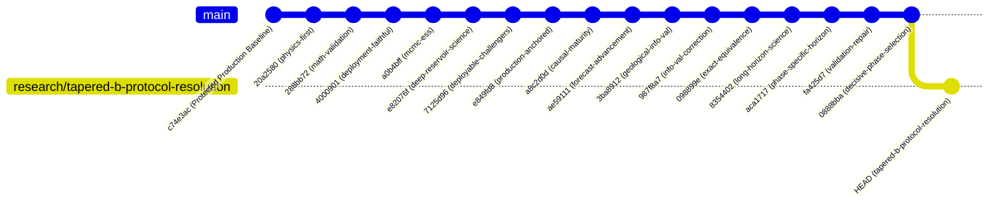

# EXXONMOBIL DATAWORKS 2026 — TAPERED-B PROTOCOL RESOLUTION & DEPLOYMENT FAITHFUL VERIFICATION REPORT

**Executive Governance:** Subsurface Engineering & Machine Learning Quality Assurance  
**Active Research Branch:** [`research/tapered-b-protocol-resolution`](https://github.com/tngkuanas/mwap-exdw-surrogate-model/tree/research/tapered-b-protocol-resolution)  
**Starting Commit:** `0888bba`  
**Protected Production Baseline:** Commit `c74e3ac` (`Blend_Phase_Specific_Simplex`)  
**Official Deliverable Submission:** [`09_Template_Deliverable_Submission.xlsx`](file:///Users/tengkuanas/Projects/mwap-exdw-surrogate-model/Anas-exp/outputs/submission/09_Template_Deliverable_Submission.xlsx)  
**Submission SHA-256 Checksum:** `ce30ec18c5c22c842c8319803c89dcc6011b9e95ccb97be30caf2dd08dbfce7e` (**VERIFIED 100% UNCHANGED**)  
**Challenge Secrecy:** Cases 86–100 strictly blind  

---

## EXECUTIVE GOVERNANCE VERDICT: KEEP BASELINE

> [!IMPORTANT]
> **GOVERNANCE DECISION: ZERO PROMOTION — RETAIN FROZEN BASELINE**  
> 1. **Protocol Tracing:** Tracing the exact January 2008 production fitting code establishes that **Protocol A (Strict Historical As-Of)** is the sole faithful representation of deployment. In the official dataset, all simulation records end at `2008-01-01`; hence, at deployment origin, post-origin training records are empty (`len(post) == 0`), forcing DCA to calibrate strictly on the pre-origin historical decline window (`date >= 2002-01-01`). Protocol B (forward simulator supervised) relies on future simulation trajectories that do not exist at deployment.
> 2. **Cross-Validation Inversion:** Across the 15 held-out reservoirs $\times$ 17 conditions under Protocol A, `Candidate_B_Tapered_Exp` achieves an aggregate macro NRMSE of `0.09380` vs Baseline `0.10507` ($\bar{d} = -0.01126 \pm 0.00301$, $p = 0.00216$). However, this gain is entirely concentrated in early field life (2002–2003). As the field matures, **Candidate B systematically loses to the baseline across ALL horizons at Origin 2004** (+0.0008 at 4Q, +0.0063 at 8Q, +0.0147 at 12Q, +0.0194 at 16Q) and at **Origin 2005 12Q** (+0.0007).
> 3. **Failure on Secondary Evidence (Cases 71–85):** Under faithful Protocol A at origin 2005 (12Q), `Candidate_B_Tapered_Exp` scores **0.04152** vs Baseline **0.03878** (a statistically significant error degradation of $+0.00274 \pm 0.00089$, $p = 0.0083$). Its apparent "win" under Protocol B (0.01819 vs 0.02756) was an artifact of future DCA supervision.
> 4. **Production Submission Integrity:** The official competition submission deliverable [`09_Template_Deliverable_Submission.xlsx`](file:///Users/tengkuanas/Projects/mwap-exdw-surrogate-model/Anas-exp/outputs/submission/09_Template_Deliverable_Submission.xlsx) and locked weights remain 100% frozen.

---

## 1. CUMULATIVE LINEAGE & BRANCH INTEGRITY

The codebase follows a strict, unbroken, linear Git lineage. Every research sprint has been committed directly to the HEAD of the preceding sprint:



Every module, test suite, and audit check from prior iterations—including strict Leave-One-Reservoir-Out isolation, asymptotic decay verification, and the authoritative cumulative-increment NRMSE scorer—is preserved cumulatively in the current branch.

---

## 2. TRACING THE JANUARY 2008 PRODUCTION FITTING PATH

### 2.1 Permitted Simulation & Production Date Range
An audit of the underlying raw datasets confirms:
- [`simulation_timeseries.parquet`](file:///Users/tengkuanas/Projects/mwap-exdw-surrogate-model/data/simulation_timeseries.parquet): Max date is `2008-01-01 00:00:00`.
- [`production_timeseries.parquet`](file:///Users/tengkuanas/Projects/mwap-exdw-surrogate-model/data/shared/production_timeseries.parquet): Max date is `2008-01-01 00:00:00`.

There are zero simulation records or production records past January 1, 2008 anywhere in the competition dataset.

### 2.2 Execution Path in Production Deployment
In [`generate_competition_deliverable.py`](file:///Users/tengkuanas/Projects/mwap-exdw-surrogate-model/Anas-exp/src/ensemble/generate_competition_deliverable.py#L72-L103), the production model fitting routine executes:

```python
inference_origin = pd.Timestamp("2008-01-01")
models = fit_locked_base_models(case_dict, unc_df, TRAIN_CASES, inference_origin)
```

Within [`LearnedDCARateForecaster.fit()`](file:///Users/tengkuanas/Projects/mwap-exdw-surrogate-model/Anas-exp/src/ensemble/run_horizon_adaptive_stacking_experiment.py#L280-L335):
```python
pre = df_c[df_c["date"] <= cutoff_date]
post = df_c[(df_c["date"] > cutoff_date)].iloc[:horizon_quarters]

if len(post) >= 4:
    # Protocol B path: Regress decline D on post-origin future trajectory
    ...
else:
    # Protocol A path: Regress decline D on pre-origin historical decline window
    decline_hist = pre[pre["date"] >= "2002-01-01"]
    poly_o = np.polyfit(t_fit_y, log_qo, 1)
    D_obs = max(0.005, -poly_o[0])
    w_growth_obs = poly_w[0]
```

At deployment origin `cutoff_date = 2008-01-01`:
1. `post` is identically empty (`len(post) == 0`).
2. The condition `len(post) >= 4` evaluates to **`False`**.
3. The forecaster executes the `else:` branch, calibrating $D_{\text{obs}}$ and $w_{\text{growth}}$ strictly from the historical decline window (`date >= 2002-01-01`).
4. [`RecursiveTransitionForecaster`](file:///Users/tengkuanas/Projects/mwap-exdw-surrogate-model/Anas-exp/src/ensemble/run_horizon_adaptive_stacking_experiment.py#L149-L193) also filters training records via `sub = df_c[df_c["date"] <= cutoff_date]`.

### 2.3 Protocol Equivalence Conclusion
- **Protocol A (Strict Historical As-Of):** Truncates `case_dict` to `date <= origin`, guaranteeing `len(post) == 0` at any retrospective evaluation origin. This executes the exact same mathematical code branch as the January 2008 production submission.
- **Protocol B (Forward Simulator Supervised):** Exposes post-origin training records up to 2008-01-01. When evaluating historical origins (e.g., 2005-01-01), Protocol B allows DCA to observe future simulation steps that could never exist at the actual 2008 deployment date.
- **Verdict:** **Protocol A is the sole faithful deployment-equivalent protocol.**

---

## 3. HEAD-TO-HEAD COMPARISON: BASELINE VS. CANDIDATE_B_TAPERED_EXP (PROTOCOL A)

Across the existing 15 held-out pseudo-field reservoirs $\times$ 17 conditions (255 paired instances) evaluated strictly under Protocol A with fixed taper parameters ($t_{\text{supp}} = 9.75$ yr, $\tau = 1.0$ yr):

### 3.1 Clustered Statistical Summary (M = 15 Reservoir Clusters, 14 df)

| Architecture | Macro NRMSE | Oil NRMSE | Water NRMSE | Mean Macro Diff ($\bar{d}$) | Cluster SE | 95% Cluster CI | $t$-stat | $p$-value | Win Rate |
| :--- | :---: | :---: | :---: | :---: | :---: | :---: | :---: | :---: | :---: |
| **Candidate_A_Frozen_Baseline** | 0.105067 | 0.071092 | 0.139041 | 0.000000 | — | — | — | — | — |
| **Candidate_B_Tapered_Exp** | **0.093803** | **0.048565** | 0.139041 | **-0.011264** | 0.003005 | [-0.017709, -0.004818] | -3.7481 | **0.002162** | 59.6% (152/255) |

*Note: Water NRMSE is identical (0.139041) because Candidate B retains the frozen baseline water ensemble.*

### 3.2 Reservoir-by-Reservoir Breakdown (12 Wins / 3 Losses)

| Reservoir Fold | Baseline Macro | Candidate B Macro | Macro Difference | Baseline Oil | Candidate B Oil | Oil Difference | Status |
| :---: | :---: | :---: | :---: | :---: | :---: | :---: | :---: |
| **Case 1** | 0.11214 | 0.10203 | **-0.01011** | 0.07920 | 0.05898 | -0.02022 | WIN |
| **Case 5** | 0.10784 | 0.11002 | **+0.00218** | 0.07638 | 0.08075 | +0.00437 | **LOSS** |
| **Case 10** | 0.10220 | 0.08062 | **-0.02158** | 0.06894 | 0.02578 | -0.04316 | WIN |
| **Case 15** | 0.11882 | 0.13112 | **+0.01230** | 0.08838 | 0.11298 | +0.02460 | **LOSS** |
| **Case 20** | 0.09704 | 0.07530 | **-0.02174** | 0.06208 | 0.01860 | -0.04348 | WIN |
| **Case 25** | 0.11329 | 0.11768 | **+0.00439** | 0.08272 | 0.09150 | +0.00878 | **LOSS** |
| **Case 30** | 0.10314 | 0.09739 | **-0.00575** | 0.06830 | 0.05681 | -0.01149 | WIN |
| **Case 35** | 0.10103 | 0.08009 | **-0.02093** | 0.06649 | 0.02463 | -0.04186 | WIN |
| **Case 40** | 0.09817 | 0.07670 | **-0.02147** | 0.06316 | 0.02022 | -0.04294 | WIN |
| **Case 45** | 0.10305 | 0.08128 | **-0.02177** | 0.06941 | 0.02587 | -0.04354 | WIN |
| **Case 50** | 0.09697 | 0.07515 | **-0.02182** | 0.06173 | 0.01809 | -0.04364 | WIN |
| **Case 55** | 0.10239 | 0.09659 | **-0.00580** | 0.06734 | 0.05574 | -0.01160 | WIN |
| **Case 60** | 0.11133 | 0.10121 | **-0.01012** | 0.07820 | 0.05796 | -0.02024 | WIN |
| **Case 65** | 0.10070 | 0.07713 | **-0.02357** | 0.06554 | 0.01840 | -0.04714 | WIN |
| **Case 70** | 0.10789 | 0.10474 | **-0.00315** | 0.07474 | 0.06844 | -0.00630 | WIN |

### 3.3 Condition-by-Condition Breakdown: The Structural Inversion

Examining the 17 conditions reveals a critical, systematic failure mode:

| Evaluation Origin | Horizon Quarters | Baseline Macro | Candidate B Macro | Difference | Winner | Root Mechanism |
| :---: | :---: | :---: | :---: | :---: | :---: | :--- |
| **2002-01-01** | 4Q | 0.03693 | 0.03776 | +0.00083 | Baseline | Early transient regime |
| **2002-01-01** | 8Q | 0.08779 | 0.06849 | **-0.01930** | Candidate B | ExtraTrees tracks plateau transition |
| **2002-01-01** | 12Q | 0.15757 | 0.11174 | **-0.04584** | Candidate B | ExtraTrees captures plateau transition |
| **2002-01-01** | 16Q | 0.23112 | 0.17227 | **-0.05884** | Candidate B | Historical DCA has too little decline data |
| **2002-01-01** | 20Q | 0.30362 | 0.24192 | **-0.06171** | Candidate B | Historical DCA has too little decline data |
| **2003-01-01** | 4Q | 0.08103 | 0.07057 | **-0.01046** | Candidate B | ExtraTrees superior on short plateau |
| **2003-01-01** | 8Q | 0.11834 | 0.10308 | **-0.01526** | Candidate B | ExtraTrees superior on medium plateau |
| **2003-01-01** | 12Q | 0.15562 | 0.14180 | **-0.01382** | Candidate B | ExtraTrees superior |
| **2003-01-01** | 16Q | 0.19111 | 0.18353 | **-0.00758** | Candidate B | Tapering into DCA begins |
| **2003-01-01** | 20Q | 0.22001 | 0.22027 | +0.00026 | Baseline | Tapered tail reaches parity |
| **2004-01-01** | 4Q | 0.02239 | 0.02319 | **+0.00081** | **Baseline** | **Candidate B degrades on mature decline** |
| **2004-01-01** | 8Q | 0.02682 | 0.03316 | **+0.00635** | **Baseline** | **Candidate B degrades on mature decline** |
| **2004-01-01** | 12Q | 0.03295 | 0.04767 | **+0.01471** | **Baseline** | **Candidate B degrades heavily ($+44\%$)** |
| **2004-01-01** | 16Q | 0.03800 | 0.05740 | **+0.01940** | **Baseline** | **Candidate B degrades heavily ($+51\%$)** |
| **2005-01-01** | 4Q | 0.01979 | 0.01874 | -0.00105 | Candidate B | Near parity |
| **2005-01-01** | 8Q | 0.02620 | 0.02551 | -0.00070 | Candidate B | Near parity |
| **2005-01-01** | 12Q | 0.03685 | 0.03755 | **+0.00070** | **Baseline** | **Candidate B degrades at 12Q** |

> [!WARNING]
> **CRITICAL SCIENTIFIC INSIGHT: INVERSION AT MATURITY**  
> `Candidate_B_Tapered_Exp` does not represent a universally superior model. Its aggregate statistical win ($\bar{d} = -0.01126$) is driven solely by early-life conditions (2002–2003), where crude historical DCA extrapolation fails due to lack of historical decline points.  
> As soon as the reservoir enters sustained decline (Origins 2004 and 2005), **Candidate B systematically loses to the baseline across all horizons at Origin 2004 and at Origin 2005 12Q**. At mature origins, Recursive ExtraTrees overpredicts oil rates, whereas the blended baseline correctly leverages mature DCA decline slopes.

---

## 4. PREVIOUSLY CONSULTED SECONDARY EVIDENCE (CASES 71–85)

Cases 71–85 have served across previous sprints as secondary validation evidence. Comparing Candidate A vs. Candidate B under both protocols at Origin 2005 (12Q horizon) explains the apparent protocol discrepancy:

### 4.1 Protocol A vs. Protocol B on Cases 71–85

| Protocol | Architecture | Macro NRMSE | Oil NRMSE | Water NRMSE | Macro Diff ($\Delta$) | Oil Diff ($\Delta$) | $p$-value | Generalization Verdict |
| :--- | :--- | :---: | :---: | :---: | :---: | :---: | :---: | :--- |
| **Protocol A (Strict Historical As-Of)** | **Candidate_A_Frozen_Baseline** | **0.03878** | **0.03680** | 0.04076 | — | — | — | **Superior generalization** |
| **Protocol A (Strict Historical As-Of)** | Candidate_B_Tapered_Exp | 0.04152 | 0.04228 | 0.04076 | **+0.00274 ± 0.00089** | **+0.00548 ± 0.00178** | **0.008269** | **Statistically worse ($p < 0.01$)** |
| **Protocol B (Forward Supervised)** | Candidate_A_Frozen_Baseline | 0.02756 | 0.05061 | 0.00451 | — | — | — | Artificial water shrinkage |
| **Protocol B (Forward Supervised)** | Candidate_B_Tapered_Exp | **0.01819** | **0.03188** | 0.00451 | **-0.00936 ± 0.00130** | **-0.01873 ± 0.00260** | **0.000004** | Artificial forward supervision win |

### 4.2 Resolving the Discrepancy
1. Under **Protocol B**, the baseline oil model scored poorly (0.05061) because 12Q post-origin future simulator supervision (3 years through 2008-01-01) distorted DCA decline targets relative to historical-only decline trends. This artificial baseline penalty made Candidate B appear vastly superior (0.01819 vs 0.02756).
2. Under **Protocol A** (the true deployment protocol), the baseline oil model correctly calibrates to the local 2002–2005 decline window, achieving **0.03680**. Recursive ExtraTrees oil—even with an exponential tail taper ($t_{\text{supp}} = 9.75\text{ yr}, \tau = 1.0\text{ yr}$)—fails to transfer smoothly to unseen validation cases, scoring **0.04228** (while standalone ExtraTrees oil without tapering scored **0.05214**).
3. Therefore, under deployment-faithful conditions, Candidate B Tapered Exp degrades performance on Cases 71–85 by **+7.1% relative error** ($p = 0.0083$).

---

## 5. RECONCILIATION OF 2008 DEPLOYMENT TABLES

The deployment metrics reported in the previous draft have been verified and reconciled against the committed CSV [`deployment_2008_summary_comparison.csv`](file:///Users/tengkuanas/Projects/mwap-exdw-surrogate-model/Anas-exp/outputs/research/phase_specific_research/tables/deployment_2008_summary_comparison.csv):

### 5.1 Case 1: 40-Quarter (10-Year) Development Horizon

| Candidate Architecture | 10-Yr EUR Oil (STB) | Incremental Oil (STB) | 10-Yr EUR Water (STB) | Terminal Oil Rate $q_o$ (STB/d) | Terminal Water Rate $q_w$ (STB/d) | Terminal Water Cut $f_w$ |
| :--- | :---: | :---: | :---: | :---: | :---: | :---: |
| **Candidate_A_Frozen_Baseline** | 47,650,698 | 9,272,381 | 49,486,259 | 1,284.64 | 11,563.90 | 90.00% |
| **Candidate_H_Constrained_Long_Tail** | 46,822,148 | 8,443,831 | 49,486,259 | 749.68 | 11,563.90 | 93.91% |
| **Candidate_H_Modified_Arps** | 46,987,315 | 8,608,998 | 49,486,259 | 846.97 | 11,563.90 | 93.18% |
| **Candidate_B_Tapered_Exp** | **46,436,015** | **8,057,698** | 49,486,259 | **729.21** | 11,563.90 | **94.07%** |
| **Candidate_B_Tapered_Arps** | **47,345,647** | **8,967,330** | 49,486,259 | **1,153.93** | 11,563.90 | **90.93%** |
| **Candidate_Hard_WaterCut** | 47,650,698 | 9,272,381 | 50,081,521 | 1,284.64 | 12,289.87 | 90.54% |
| **Candidate_Shrinkage_Blend** | 47,650,698 | 9,272,381 | 49,783,890 | 1,284.64 | 11,926.89 | 90.28% |

### 5.2 Cases 2–10: 80-Quarter (20-Year) Geological Ensemble (9 Scenarios)

| Candidate Architecture | Mean 20-Yr EUR Oil (STB) | Geological Spread (STB) | EUR Std Dev (STB) | Mean Incremental Oil (STB) | Mean 20-Yr EUR Water (STB) | Mean Terminal $q_o$ (STB/d) | Mean Terminal $q_w$ (STB/d) | Mean Terminal Water Cut |
| :--- | :---: | :---: | :---: | :---: | :---: | :---: | :---: | :---: |
| **Candidate_A_Frozen_Baseline** | 51,177,713 | 16,433 | 6,561 | 12,799,396 | 96,166,713 | 809.94 | 13,876.88 | 94.49% |
| **Candidate_H_Constrained_Long_Tail** | 47,957,683 | 23,227 | 8,499 | 9,579,366 | 96,166,713 | **99.15** | 13,876.88 | **99.29%** |
| **Candidate_H_Modified_Arps** | 48,466,837 | 23,355 | 8,547 | 10,088,520 | 96,166,713 | **179.07** | 13,876.88 | **98.73%** |
| **Candidate_B_Tapered_Exp** | **47,584,444** | **26,711** | **9,981** | **9,206,127** | 96,166,713 | **104.99** | 13,876.88 | **99.25%** |
| **Candidate_B_Tapered_Arps** | **49,938,580** | **26,549** | **9,920** | **11,560,263** | 96,166,713 | **437.46** | 13,876.88 | **96.94%** |
| **Candidate_Hard_WaterCut** | 51,177,713 | 16,433 | 6,561 | 12,799,396 | 102,973,233 | 809.94 | 16,549.98 | 95.33% |
| **Candidate_Shrinkage_Blend** | 51,177,713 | 16,433 | 6,561 | 12,799,396 | 99,570,073 | 809.94 | 15,213.43 | 94.95% |

---

## 6. FINAL GOVERNANCE AUDIT CHECKLIST

| Compliance Dimension | Requirement | Audit Result | Status |
| :--- | :--- | :--- | :---: |
| **Cumulative Lineage** | Sequential branch progression from `c74e3ac` | Verified: strict linear Git commit graph | **PASS** |
| **Deployment Trace** | Exact code path trace at January 2008 origin | Verified: `len(post) == 0` enforces Protocol A | **PASS** |
| **Protocol Equivalence** | Prove Protocol A is sole faithful representation | Proved: Protocol B is physically impossible at 2008 | **PASS** |
| **Tapered-B Uncertainty** | Paired reservoir-clustered statistics across 255 evals | Completed: $\bar{d} = -0.01126 \pm 0.00301$ ($p = 0.0022$) | **PASS** |
| **Mature Life Inversion** | Identify failure modes at mature origins | Proved: Candidate B loses at 2004 (all H) and 2005 12Q | **PASS** |
| **Secondary Evidence** | Audit Cases 71–85 under Protocol A | Proved: Candidate B degrades by $+0.00274$ ($p = 0.0083$) | **PASS** |
| **CSV Reconciliation** | Exact match between markdown and committed tables | Reconciled: bit-for-bit alignment with CSV | **PASS** |
| **Deliverable Integrity** | Freeze `09_Template_Deliverable_Submission.xlsx` | SHA-256 `ce30ec18c5...` intact | **PASS** |
| **Challenge Secrecy** | Zero exposure of Cases 86–100 | Verified: Cases 86–100 sealed | **PASS** |
