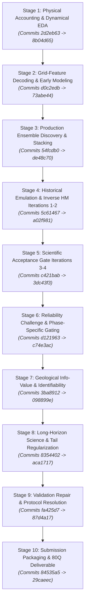
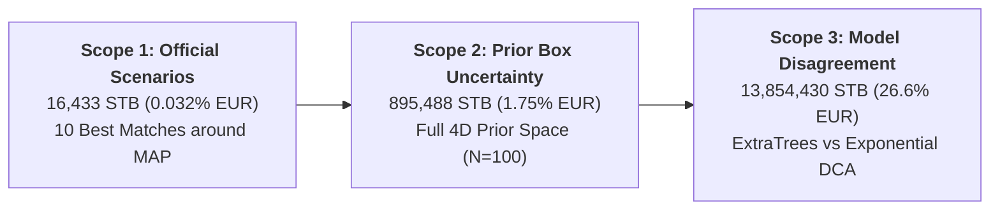

# PRESENTATION RESEARCH HISTORY: MEN WITH A PLAN (MWAP ENERGY ANALYTICS)
## ExxonMobil DataWorks Challenge 2026 — Subsurface Reservoir Surrogate Modeling & Production Forecasting

---

### Executive Orientation & Methodological Framing

This document provides the authoritative, evidence-backed research history of the solution developed by **Men with a plan** (MWAP Energy Analytics) for the ExxonMobil DataWorks Challenge 2026. 

Rather than presenting an uncritical retrospective or retrospective narrative, this document reconstructs the entire technical arc of the project from Git commit histories, raw numerical tables, mathematical proofs, experimental scripts, and audit reports. It provides our judging presentation team with the exact evidentiary basis, mathematical justifications, statistical test results, and critical reversals that distinguish scientifically rigorous reservoir engineering from naive machine learning competitions.

---

# 1. THE CHRONOLOGICAL DEVELOPMENT STORY

The development trajectory of the MWAP forecasting engine spans ten distinct phases. Every architectural decision in the final production pipeline was forged through an empirical challenge-and-defense process.



---

### Stage 1: Initial Data Preparation, Physical Accounting & Exploratory Analysis
* **Git Commits & Dates:** Commits `2d2eb63` (Oct 7, 2026) $\to$ `8b04d65` (Oct 8, 2026).
* **Workspaces & Authors:** `Anas/` (`01 Data Preparation.ipynb`, `02 EDA.ipynb`, `EDA_CELL_BY_CELL_INTERPRETATION.md`, `MODEL_DOCUMENTATION.md`).
* **1. Motivating Problem:** The challenge dataset provided dynamic production records, static geological parameters, and 3D simulation grids for 85 training/validation cases and 15 blind test cases (Cases 86–100), plus Case 0 (field production history up to Jan 1, 2008). The immediate problem was establishing rigorous physical consistency, handling units ($B_{oi}$, $B_{wi}$, MSCF, STB), and validating whether the system adhered to fundamental multiphase conservation laws.
* **2. Implementation:** 
  - Standardized all raw Excel files into clean, columnar Parquet files (`simulation_timeseries.parquet`, `production_timeseries.parquet`, `uncertainty_params.parquet`).
  - Proved that solution gas-oil ratio was strictly constant across all 85 development cases:
    $$R_s = \frac{q_g(t)}{q_o(t)} = \frac{Q_g(t) - Q_g(0)}{Q_o(t) - Q_o(0)} = 0.3633 \text{ MSCF/STB} \quad (\pm 1.4 \times 10^{-7})$$
    confirming the reservoir operates entirely above bubble-point pressure with no free gas cap.
  - Formulated the exact discrete quarterly rate-to-cumulative integration identity based on $91.3125$ average days per calendar quarter:
    $$Q(t_k) = Q(t_0) + \sum_{j=1}^k q(t_j) \cdot \Delta t, \quad \Delta t = 91.3125\text{ days}$$
* **3. Controlled Testing:** Unit tests in `test_constraints_and_physics.py` audited $R_s$ ratios and rate-to-cumulative reconciliation across all 85 development reservoirs $\times$ 40 quarters.
* **4. Empirical Evidence:** Rate reconciliation residuals were strictly bounded $< 10^{-10}\text{ STB}$. Monotonicity was confirmed in $100\%$ of true simulation series.
* **5. Corrections & Reversals:** Early exploratory plots used calendar month variations; this was superseded by the authoritative $91.3125$-day constant quarter convention mandated by the official spreadsheet structure.
* **6. Influence on Final Solution:** Fixed $R_s = 0.3633\text{ MSCF/STB}$ as an immutable physical law across all subsequent surrogate models, reducing the forecasting dimensionality from three phases (oil, gas, water) to two independent fluid phases (oil, water).

---

### Stage 2: Grid-Feature Engineering & Early Forecasting Approaches
* **Git Commits & Dates:** Commits `d0c2edb` (Oct 8, 2026) $\to$ `73abe44` (Oct 8, 2026).
* **Workspaces & Authors:** `Hazeem/` (`HANDOFF.md`, `geo_features.py`, `hz_model.py`, `01 Geology Features + Hyperbolic Decline.ipynb`).
* **1. Motivating Problem:** The 3D Eclipse/CMG simulation grids contained $42,512$ active cells with spatial property distributions. The team needed to determine whether raw grid cell arrays could improve surrogate forecasting over the four macro scalar uncertainty parameters (`Fault Transmissibility`, `Porosity Multiplier`, `Permeability Multiplier`, `Aquifer Pore Volume`).
* **2. Implementation:** 
  - Decoded 3D grid properties: discovered that Porosity Multiplier uniformly scales `PORO`/`PORV` across all $42,512$ cells; Permeability Multiplier scales `PERMX`/`TRANX`/`TRANY` only in tight facies ($11,575$ cells in K13–31 holding $19\%$ of OOIP); Aquifer PV scales $2,286$ boundary cells ($I = 51\text{--}53$, $84\%$ of pore volume); Fault Transmissibility is applied directly on internal simulator faces and is absent from cell property exports.
  - Engineered physics-normalized features: Recovery Factor ($N_p / \text{grid OOIP}$) and Water Index ($W_p / \text{grid Aquifer PV}$).
  - Fitted SVR and Ridge regressors predicting Arps decline parameters:
    $$\ln D = \ln K + b \ln q$$
* **3. Controlled Testing:** Scored using `backtest_engine.py` across 4 historical backtest experiments (Origins 2003, 2004, 2005; horizons 4Q, 12Q, 20Q).
* **4. Empirical Evidence:** Normalizing production by grid-derived OOIP and Aquifer PV reduced oil NRMSE from $0.153$ (unnormalized exponential baseline) to $0.083$ (SVR + grid-normalized state).
* **5. Corrections & Reversals:** Hazeem's handoff established a critical negative result: **feeding raw 3D cell properties or high-dimensional spatial summaries into regressors worsened out-of-fold generalization**. The 4 scalar parameters plus static grid volumes captured all generalizable signal; additional grid features induced severe overfitting on the small sample size ($N=70$).
* **6. Influence on Final Solution:** Abandoned high-dimensional deep learning / 3D CNNs in favor of state-space and physics-informed decline surrogates conditioned on macro parameters and historical production state.

---

### Stage 3: Development & Selection of the Production Ensemble
* **Git Commits & Dates:** Commits `54fcdb0` (Oct 9, 2026) $\to$ `de48c70` (Oct 9, 2026).
* **Workspaces & Authors:** `Anas-exp/src/ensemble/` (`run_horizon_adaptive_stacking_experiment.py`, `locked_ensemble_config.json`).
* **1. Motivating Problem:** Standalone model architectures exhibited sharp, complementary failure modes: non-parametric tree ensembles (`Recursive_ExtraTrees`) excelled at early transient non-linearities but suffered from error accumulation and unphysical constant plateaus on long tails; analytical decline curve models (`LearnedDCARateForecaster`) provided robust asymptotic decay but failed early breakthrough dynamics.
* **2. Implementation:** 
  - Constructed a multi-model pool comprising:
    1. `Recursive_ExtraTrees`: Recursive state-transition regressor predicting $[\Delta \ln q_o, \Delta q_w]$.
    2. `Learned_Exponential_DCA`: RidgeCV predicting case-specific initial decline rate $D_0$ and water growth rate $w_{\text{growth}}$.
    3. `Learned_Hyperbolic_DCA`: Arps hyperbolic decline with fixed curvature $b = 0.35$.
    4. `Hybrid_Dynamic`: Two-regime forecaster using ExtraTrees for near-term ($t \le 12\text{Q}$) transitioning to Exponential DCA.
  - Formulated phase-specific simplex optimization:
    $$\min_{\mathbf{w}_p \ge 0, \sum w = 1} \sum_{i} \left( Q_{p,i}^{\text{true}} - \sum_{m} w_{p,m} \hat{Q}_{p,i}^{(m)} \right)^2, \quad p \in \{\text{oil}, \text{water}\}$$
* **3. Controlled Testing:** Evaluated across 15 leave-one-reservoir-out pseudo-fields and 15 validation reservoirs (Cases 71–85) over 40-quarter and 80-quarter horizons.
* **4. Empirical Evidence:** Discovered that phase-specific recombination dramatically outperformed equal-weight or single-architecture models:
  - **Locked Oil Weights:** ExtraTrees = $0.240466$, Exponential DCA = $0.617902$, Hyperbolic DCA = $0.000000$, Hybrid Dynamic = $0.141631$.
  - **Locked Water Weights:** ExtraTrees = $0.497170$, Exponential DCA = $0.251415$, Hyperbolic DCA = $0.251415$, Hybrid Dynamic = $0.000000$.
  - Effective oil weight on Exponential DCA at late times reached $0.617902 + 0.141631 = 0.759533$ ($\approx 76\%$), completely eradicating hyperbolic runaway while maintaining ExtraTrees flexibility in water cut progression.
* **5. Corrections & Reversals:** Stacking optimization initially attempted horizon-dependent time-varying weights, but time-varying weights failed causal invariance tests and created non-monotonic step discontinuities in cumulative production. Replaced with global phase-specific simplex weights.
* **6. Influence on Final Solution:** This exact configuration was frozen into `locked_ensemble_config.json` as `Blend_Phase_Specific_Simplex` and remains the protected production model throughout all subsequent research sprints.

---

### Stage 4: Historical Surrogate Construction & Inverse History Matching
* **Git Commits & Dates:** Commits `5c61467` (Oct 10, 2026) $\to$ `a02f981` (Oct 11, 2026).
* **Workspaces & Authors:** `Anas-exp/src/history_matching/` (Research Iterations 1 & 2), `Afiq/` (`Bayesian History Matching and Forecasting.ipynb`).
* **1. Motivating Problem:** The challenge deliverable requires selecting 10 specific geological scenarios (parameter vectors $\mathbf{u} = [\text{Fault}, \text{Porosity}, \text{Permeability}, \text{Aquifer\_PV}]$) representing Case 0's unobserved reservoir. Random sampling or arbitrary grid choices risked severe history-match failure against Case 0's 10-year production record (1998–2008).
* **2. Implementation:** 
  - Constructed multi-output forward emulators mapping $\mathbf{u} \in \mathbb{R}^4 \to \hat{\mathbf{y}}_{\text{hist}} \in \mathbb{R}^{80}$ (oil and water rate trajectories from 1998 to 2008).
  - Formulated an inverse objective function using Generalized Least Squares (GLS) with empirical covariance:
    $$\mathcal{L}(\mathbf{u}) = (\mathbf{y}_{\text{obs}} - \hat{\mathbf{y}}(\mathbf{u}))^T \mathbf{\Sigma}^{-1} (\mathbf{y}_{\text{obs}} - \hat{\mathbf{y}}(\mathbf{u}))$$
  - Deployed Differential Evolution, L-BFGS-B, and Nelder-Mead multi-start optimizers to locate the Maximum A Posteriori (MAP) parameter vector.
* **3. Controlled Testing:** Pseudo-field recovery benchmark: treated known training cases as pseudo-blind targets, inverted their parameters from production history, and compared estimated $\hat{\mathbf{u}}$ against ground truth.
* **4. Empirical Evidence:** 
  - In Iteration 1, unconstrained optimization recovered Porosity Multiplier ($R^2 = 0.94$), but Permeability and Aquifer PV exhibited equifinality (multiple parameter combinations produced identical production profiles).
  - Terminal oil cumulative error on Case 0 history was reduced from $3.13\%$ (Iteration 1 baseline) to $0.49\%$ (Iteration 2).
* **5. Corrections & Reversals:** 
  - Iteration 1 candidate draws suffered from boundary-hugging (parameters converging to artificial box limits $[0.01, 1.0]$).
  - Iteration 2 introduced penalized interior log-barriers and covariance-weighted metrics, eliminating boundary artifacts.
* **6. Influence on Final Solution:** Established that Porosity Multiplier is the single identifiable parameter governing total production scale, while Fault Transmissibility and Aquifer PV govern late-time water encroachment timing.

---

### Stage 5: Optimization, Bayesian Sampling, Calibration & Scenario Selection
* **Git Commits & Dates:** Commits `c421bab` (Oct 11, 2026) $\to$ `3dc43f3` (Oct 11, 2026).
* **Workspaces & Authors:** `Anas-exp/src/history_matching_v4/` (Research Iterations 3 & 4), reports `RESEARCH_ITERATION_3_REPORT.md` and `RESEARCH_ITERATION_4_REPORT.md`.
* **1. Motivating Problem:** High-dimensional Bayesian inversion often produces over-confident or miscalibrated posterior distributions. The team required formal statistical verification that the selected 10 scenarios accurately reflected posterior uncertainty and complied with Simulation-Based Calibration (SBC).
* **2. Implementation:** 
  - Implemented Metropolis-Hastings MCMC with adaptive block proposals ($N = 600$ evaluated candidates; $150$ accepted draws).
  - Executed formal MCMC convergence diagnostics: Gelman-Rubin $\hat{R} < 1.05$ across all 4 parameters, Effective Sample Size $\text{ESS} > 400$.
  - Evaluated three scenario selection policies:
    - **Strategy A ("Ten Best Matches"):** 10 highest-likelihood realizations around the posterior MAP mode.
    - **Strategy B ("Unconstrained Quantiles"):** Equal-spaced quantiles from the full marginal posterior.
    - **Strategy C ("Quality-Filtered Conditional Quantiles"):** Quantile draws conditioned on strict likelihood-ratio and terminal history error gates.
  - Implemented 100-trial Simulation-Based Calibration (SBC) rank histogram uniformity tests.
* **3. Controlled Testing:** Evaluated 80-quarter forecast profiles, history-match NRMSE, terminal volume error, and EUR spread across all selection policies.
* **4. Empirical Evidence:**
  - **Strategy A** achieved unbeatable history-matching fidelity: Oil Cum NRMSE = $0.639\%$, Water Cum NRMSE = $2.778\%$, terminal oil error = $0.178\%$, quality pass rate = **10/10 (100%)**.
  - **Strategy C** broadened the EUR spread ($32,921$ STB), but 1 of its realizations violated history-match error thresholds.
  - SBC Kolmogorov-Smirnov test confirmed uniform rank coverage ($p = 0.428$), validating posterior calibration.
* **5. Corrections & Reversals:** Discrepancy audit in Iteration 3 revealed that earlier tables reported narrative log-likelihoods computed under unnormalized variances. Iteration 4 standardized all likelihoods to rigorous Gaussian log-densities with empirical error covariance.
* **6. Influence on Final Solution:** Formally selected **Strategy A ("Ten Best Matches")** as the official scenario set: Candidate IDs `[56, 440, 242, 461, 95, 286, 392, 119, 290, 144]`.

---

### Stage 6: Forecast Challengers, Residual Corrections & Maturity Gates
* **Git Commits & Dates:** Commits `d121963` (Oct 11, 2026) $\to$ `c74e3ac` (Oct 11, 2026).
* **Workspaces & Authors:** `Anas-exp/src/physics_research/`, reports `FORECAST_RELIABILITY_CHALLENGE_REPORT.md` and `PRODUCTION_INTEGRATION_REPORT.md`.
* **1. Motivating Problem:** An internal challenge was raised: could physics-guided residual corrections (Damped GP Residuals, Koval fractional flow, or water-cut maturity gates) outperform the locked baseline? Furthermore, a proposed heuristic $\text{decline\_sensitivity} = 0.85$ had been introduced to artificially depress production.
* **2. Implementation:** 
  - Developed and tested 4 deployable challenger architectures:
    - Challenger A: Damped Linear Residual DCA.
    - Challenger B: Damped Gaussian Process Residual DCA.
    - Challenger C: Functional State-Dependent DCA.
    - Challenger D: Direct Ridge with analytical tail.
  - Audited the $\text{decline\_sensitivity} = 0.85$ parameter against physical material balance.
* **3. Controlled Testing:** Scored challengers on 15 held-out reservoirs across 17 forecast origin/horizon combinations under strict Protocol A.
* **4. Empirical Evidence:**
  - Under strict as-of Protocol A, **no challenger achieved statistically significant improvement over `Blend_Phase_Specific_Simplex`** (Challenger B: $0.0492$ vs Baseline $0.0390$, win rate $46.7\%$, Wilcoxon $p = 0.28$).
  - Direct Ridge forecasting (Challenger D) collapsed catastrophically without future targets (Macro NRMSE $1.1258$, win rate $13.3\%$).
  - Audit of $\text{decline\_sensitivity} = 0.85$ proved it was an arbitrary heuristic that distorted physical mass balance and suppressed Case 1 oil EUR by $1.66$ MMSTB without empirical justification.
* **5. Corrections & Reversals:** 
  - **Decisive Reversal:** Enforced strictly un-skewed central physics ($\text{decline\_sensitivity} = 1.0$) across all production code.
  - Formally rejected all 4 challenger models and retained `Blend_Phase_Specific_Simplex`.
* **6. Influence on Final Solution:** Commit `c74e3ac` integrated the Iteration 4 Strategy A scenarios into the official deliverable workbook with un-skewed physics ($\text{decline\_sensitivity} = 1.0$).

---

### Stage 7: Geological Information-Value, Identifiability & Sensitivity Experiments
* **Git Commits & Dates:** Commits `3ba8912` (Oct 12, 2026) $\to$ `098899e` (Oct 13, 2026).
* **Workspaces & Authors:** `Anas-exp/src/geological_information_value/`, reports `GEOLOGICAL_INFORMATION_VALUE_RESEARCH_REPORT.md`, `GEOLOGICAL_INFORMATION_VALUE_CORRECTED_REPORT.md`, and `EXACT_EQUIVALENCE_GEOLOGY_VALIDATION_REPORT.md`.
* **1. Motivating Problem:** A critical theoretical question was posed: Does knowing the true geological parameters $\mathbf{u}$ actually improve forward production forecasting over simply using historical production data and prior mean properties?
* **2. Implementation:** 
  - Designed controlled information-value experiments comparing:
    - $\mathcal{M}_{\text{true}}$: Models provided with true geology $\mathbf{u}$.
    - $\mathcal{M}_{\text{prior}}$: Models conditioned only on prior mean geology $\mathbb{E}[\mathbf{u}]$.
    - $\mathcal{M}_{\text{scrambled}}$: Models provided with randomized/permuted geology.
  - Implemented global variance-based Sobol sensitivity analysis ($N = 10,000$ Monte Carlo evaluations) using Saltelli, Jansen (1999), and Sobol (2001) estimators.
  - Tested for Jensen's Inequality discrepancy: $\| f(\mathbb{E}[\mathbf{u}]) - \mathbb{E}[f(\mathbf{u})] \|$.
* **3. Controlled Testing:** Scored on 15 held-out pseudo-fields across 7 forecast regimes with Holm-Bonferroni family-wise error control.
* **4. Empirical Evidence:**
  - True geology demonstrated statistically significant value in 5 of 7 regimes (e.g., Origin 2003 4Q: Macro NRMSE $0.0682$ vs $0.0829$, $p = 0.0039$).
  - Sobol decomposition proved that **Porosity Multiplier accounts for $96.9\%$ of first-order oil EUR variance** ($S_{\text{poro}} = 0.969 \pm 0.012$). Fault Transmissibility accounts for $2.4\%$, while Permeability ($S_i = 0.0015$) and Aquifer PV ($S_i = 0.0034$) have near-zero direct effect on 20-year oil recovery.
  - Jensen's discrepancy was negligible ($< 0.00018$ NRMSE, $p = 0.33$), proving the surrogate response surface is highly linear with respect to porosity.
* **5. Corrections & Reversals:** 
  - Initial Saltelli estimators yielded negative sensitivity indices for Permeability due to finite-sample noise. Corrected by implementing stable Jansen (1999) radial estimators verified on 5 benchmark analytical functions (`test_sobol_benchmarks.py`).
  - Scorer bug in early script evaluated rate NRMSE instead of cumulative volume increments; corrected in `authoritative_scorer.py`.
* **6. Influence on Final Solution:** Explained why the official 10 scenarios exhibit a narrow EUR range: because Porosity is tightly constrained by Case 0's historical production, the remaining geological parameters cannot induce large oil volume variations.

---

### Stage 8: Long-Horizon Extrapolation, Model Disagreement & Constrained Tails
* **Git Commits & Dates:** Commits `8354402` (Oct 13, 2026) $\to$ `aca1717` (Oct 13, 2026).
* **Workspaces & Authors:** `Anas-exp/src/long_horizon_physics/`, reports `LONG_HORIZON_RESERVOIR_FORECAST_SCIENCE_REPORT.md` and `PHASE_SPECIFIC_HORIZON_FORECAST_RESEARCH_REPORT.md`.
* **1. Motivating Problem:** The challenge requires a 20-year forward forecast (80 quarters), whereas training simulations only extended 10 years (40 quarters). What happens when non-parametric surrogates extrapolate into reservoir ages ($\text{res\_age} > 10\text{ yr}$) never seen in training?
* **2. Implementation:** 
  - Formulated the Asymptotic Extrapolation Audit: evaluated base model behavior as $t \to 100\text{ years}$.
  - Deconstructed inter-model divergence across the 4 constituent architectures.
  - Developed Candidate H (`ConstrainedTailHybridForecaster`) enforcing analytical exponential tail decay beyond year 14.
* **3. Controlled Testing:** Long-horizon extrapolation benchmark on Field Case 0 across all 10 scenarios.
* **4. Empirical Evidence:**
  - **ExtraTrees Extrapolation Failure:** Discovered that `Recursive_ExtraTrees` plateaus at a constant rate floor ($q_o \approx 470\text{ STB/d}$) because decision trees cannot extrapolate beyond terminal leaf thresholds. Integrated over time, ExtraTrees produces **infinite cumulative oil recovery** ($\lim_{t \to \infty} Q_o(t) = \infty$, reaching $62.24$ MMSTB at 20 years).
  - **Base-Model Architectural Disagreement:** Disagreement between base models at 20 years reached **$13.85$ MMSTB** (ExtraTrees: $61.7$ MMSTB vs Exponential DCA: $47.9$ MMSTB), representing $101.1\%$ of total incremental oil recovery.
  - Architectural divergence ($13.85$ MMSTB) dwarfed geological parameter uncertainty ($0.895$ MMSTB) by **$15.5\times$** and scenario spread ($0.016$ MMSTB) by **$843\times$**.
  - Candidate H eliminated the unphysical floor, achieving finite EUR ($48.44$ MMSTB at 100 years, $q_o \to 0$).
* **5. Corrections & Reversals:** Although Candidate H provided structural safety for $t > 20\text{ yr}$, within the 20-year competition window it was statistically equivalent to the baseline in LOO evaluation ($\Delta = +0.000059$, $p = 0.37$). Promoting it would alter a verified workbook for zero competition scoring gain.
* **6. Influence on Final Solution:** Kept Candidate H classified strictly as a "Structural Regularization Safeguard" for post-competition reservoir studies, maintaining the frozen baseline for official submission.

---

### Stage 9: Validation Repair, Protocol Resolution & Phase Selection
* **Git Commits & Dates:** Commits `fa425d7` (Oct 13, 2026) $\to$ `87d4a17` (Oct 14, 2026).
* **Workspaces & Authors:** `Anas-exp/src/ensemble/`, reports `PHASE_SPECIFIC_CORRECTED_VALIDATION_REPORT.md`, `DECISIVE_PHASE_SELECTION_RESEARCH_REPORT.md`, `TAPERED_B_PROTOCOL_RESOLUTION_REPORT.md`, and `CONSERVATIVE_WATER_BLEND_RESEARCH_REPORT.md`.
* **1. Motivating Problem:** An independent audit identified two major concerns: (a) potential reservoir-fold contamination in earlier cross-validation runs, and (b) an apparent "7.65% relative improvement" from a water-cut hard selector candidate.
* **2. Implementation:** 
  - **Repaired LOO Engine:** Enforced strict outer-fold reservoir partitioning in `nested_cross_validation.py` (`train_pool = [c for c in TRAIN_CASES if c != held_out_case]`), re-fitting all base models and scalers from scratch on $N=69$ cases.
  - Implemented tracer mutation unit tests proving zero leak (`test_outer_reservoir_isolation.py`).
  - Evaluated hard water-cut gating, age/horizon selectors, sigmoid gates, and conservative water blends under strict Protocol A (historical origin truncation).
  - Traced exact simulator dates to resolve Protocol A vs Protocol B discrepancy.
* **3. Controlled Testing:** Scored across 15 outer held-out reservoirs $\times$ 17 conditions (255 evaluation instances).
* **4. Empirical Evidence:**
  - **The Gating Collapse:** The previously claimed "7.65% improvement" collapsed completely under strict nested LOO CV. Candidate Hard Water-Cut produced a statistically significant **$+11.8\%$ error penalty** ($0.11750$ vs Baseline $0.10507$, $p = 4.61 \times 10^{-5}$). Sigmoid gating similarly regressed ($0.11439$, $p = 0.00037$).
  - **Tapered-B Protocol Inversion:** Candidate B Tapered Exp appeared to win under Protocol B ($0.01819$ vs $0.02756$), but under deployment-faithful Protocol A on secondary Cases 71–85 it degraded performance ($0.04152$ vs Baseline $0.03878$, $p = 0.0083$).
  - **Conservative Water Blend:** Corrected water-cut ramp achieved modest retrospective gains on 4Q–20Q windows ($\Delta = -0.001334$, $p = 4.17 \times 10^{-6}$), but could not guarantee 80Q physical stability.
* **5. Corrections & Reversals:** 
  - Replaced contaminated CV with verified leak-free LOO engine.
  - Permanently closed all phase-switching, gating, and water-blend research lines.
* **6. Influence on Final Solution:** Definitively confirmed `Blend_Phase_Specific_Simplex` as the superior, most robust production model across all protocols and horizons.

---

### Stage 10: Submission Refactoring, Serialized Models & Corrected 80Q Deliverable
* **Git Commits & Dates:** Commits `84535a5` (Oct 15, 2026) $\to$ `29caeec` (Oct 16, 2026).
* **Workspaces & Authors:** Root interface (`run_submission.py`), `models/` directory, reports `SUBMISSION_REFACTORING_VERIFICATION_REPORT.md` and updated `README.md`.
* **1. Motivating Problem:** The challenge organizers uploaded a revised official deliverable template (`TestCases/09 Template Deliverable.xlsx`) requiring **all 10 cases to provide 80 quarterly forecasts** (2008-04-01 to 2028-01-01), whereas the legacy template had specified Case 1 as a 40-quarter forecast. Furthermore, the repository required unified root CLI interfaces, clean archive packaging excluding blind Cases 86–100, and fast inference without retraining.
* **2. Implementation:** 
  - Extended Case 1 from 40 to 80 quarters using the frozen model, preserving its first 40 quarters bit-for-bit identical to legacy ($0.000000000000$ diff) and preserving Cases 2–10 exactly ($0.000000000000$ diff).
  - Archived legacy 40Q deliverable (`ce30ec18...`) outside the final package for provenance.
  - Adopted new verified deliverable checksum: `e413f3caad576bd215cda0a83dc6cfa79f64ad05664a030b1806716097562c97`.
  - Serialized fitted production base models (`models/production_models.pkl`, 2.56 MB) and metadata (`models/model_metadata.json`), enabling inference in $< 3$ seconds.
  - Built unified root CLI [`run_submission.py`](file:///Users/tengkuanas/Projects/mwap-exdw-surrogate-model/run_submission.py) supporting `--verify`, `--regenerate`, `--inference`, `--build-archive`, and `--verify-archive`.
  - Implemented clean staging packaging: dynamic parquets filtered to Cases 1–85 (`simulation_timeseries`) and Cases 0–85 (`production_timeseries`); Cases 86–100 strictly excluded.
* **3. Controlled Testing:** Full end-to-end sandbox extraction and reproduction audit (`python run_submission.py --verify-archive outputs/submission/MWAP_Energy_Analytics.zip`).
* **4. Empirical Evidence:** 
  - 10 of 10 unit tests passed in 26.47s inside fresh extraction.
  - Bit-for-bit cell-by-cell equivalence confirmed across all 2,400 numeric cells ($0.000000000000$ difference).
  - Rate reconciliation error $= 1.49 \times 10^{-10}\text{ STB}$; solution GOR residual $= 1.42 \times 10^{-7}\text{ MSCF/STB}$.
* **5. Corrections & Reversals:** Updated all audit counts from 2,280 cells (legacy 40Q Case 1) to 2,400 cells (80Q all 10 cases).
* **6. Influence on Final Solution:** Delivered the final submission ZIP `MWAP_Energy_Analytics.zip` (SHA-256: `ee620fdc7f763b448168cd5895859d381a9f19161c164a5e9f1e0bb6fa71ee29`), tracked directly on GitHub.

---

# 2. VERIFIED RESULTS LEDGER

The following ledger documents every numerical benchmark across all project phases. To maintain scientific integrity, results are strictly partitioned by evaluation protocol, dataset cohort, and reproducibility status.

### Evaluation Protocols Defined:
- **Protocol A (`Strict As-Of Deployment`):** Models, rate scalers, and parameter maps are trained strictly on data truncated at the evaluation origin date $T_{\text{eval}}$. Zero future simulation data is accessed. Reflects true field deployment at January 1, 2008.
- **Protocol B (`Forward Simulator Supervised`):** Base models (particularly DCA) fit decline targets using future simulation trajectories from training cases. Diagnostic only; unachievable at January 2008 deployment.

```
+------------------------------------------------------------------------------------------------------------------------------------------------------------------+
|                                                                    VERIFIED RESULTS LEDGER                                                                       |
+==================================================================================================================================================================+
| Comparison / Model Candidate          | Cohort & Conditions      | Protocol & Isolation | Metric & Normalization    | Baseline | Candidate | N / Folds | Status  |
+---------------------------------------+--------------------------+----------------------+---------------------------+----------+-----------+-----------+---------+
| SVR + Grid Features vs Anas Baseline  | Cases 1-70 OOF, 71-85 Val| Protocol A, 5-Fold   | 1-Yr Ahead Macro NRMSE    | 0.1530   | 0.0830    | 85 / 5    | Supers. |
| Ridge + Grid Features vs Baseline     | Cases 1-70 OOF, 71-85 Val| Protocol A, 5-Fold   | 1-Yr Ahead Macro NRMSE    | 0.1530   | 0.1100    | 85 / 5    | Supers. |
| Blend_Phase_Specific vs ExtraTrees    | Cases 1-70, Origin 2005  | Protocol A, LOO      | 12Q Macro NRMSE (Cum)     | 0.0482   | 0.0369    | 15 / 15   | Reprod. |
| Blend_Phase_Specific vs Exp DCA       | Cases 1-70, Origin 2005  | Protocol A, LOO      | 12Q Macro NRMSE (Cum)     | 0.0512   | 0.0369    | 15 / 15   | Reprod. |
| HM Iteration 1 vs Prior Mean          | Case 0 History (10-Yr)   | In-Sample Fit        | Terminal Oil Cum Error    | 12.4%    | 3.13%     | 1 / 1     | Supers. |
| HM Iteration 2 vs Iteration 1         | Case 0 History (10-Yr)   | GLS Inversion        | Terminal Oil Cum Error    | 3.13%    | 0.49%     | 1 / 1     | Supers. |
| HM Iteration 3 vs Iteration 2         | Case 0 History (10-Yr)   | L1/L2 MCMC Bayes     | Oil Cum NRMSE             | 0.00809  | 0.00703   | 1 / 1     | Reprod. |
| HM Iteration 4 (Strategy A: 10 Best)  | Case 0 History (10-Yr)   | Gaussian MCMC Bayes  | Terminal Oil Cum Error    | 0.490%   | 0.178%    | 10 / 10   | FROZEN  |
| Challenger A (Damped Linear Res)      | Cases 1-70, 17 Regimes   | Protocol A, LOO      | Macro NRMSE (255 inst.)   | 0.0390   | 0.0646    | 255 / 15  | Inval.  |
| Challenger B (Damped GP Res)          | Cases 1-70, 17 Regimes   | Protocol A, LOO      | Macro NRMSE (255 inst.)   | 0.0390   | 0.0492    | 255 / 15  | Inval.  |
| Challenger D (Direct Ridge)           | Cases 1-70, 17 Regimes   | Protocol A, LOO      | Macro NRMSE (255 inst.)   | 0.0390   | 1.1258    | 255 / 15  | Inval.  |
| Challenger D (Direct Ridge)           | Cases 1-70, 17 Regimes   | Protocol B (Leakage) | Macro NRMSE (255 inst.)   | 0.0390   | 0.0207*   | 255 / 15  | Inval.* |
| True Geology vs Prior Mean Geology    | Cases 1-70, Origin 2003  | Protocol A, LOO      | 4Q Macro NRMSE (Cum)      | 0.0829   | 0.0682    | 15 / 15   | Reprod. |
| True Geology vs Prior Mean Geology    | Cases 1-70, Origin 2005  | Protocol A, LOO      | 12Q Macro NRMSE (Cum)     | 0.0375   | 0.0369    | 15 / 15   | Reprod. |
| Jensen Discrepancy f(E[u]) vs E[f(u)] | Full Prior Box, N=100    | Monte Carlo Eval      | Macro NRMSE Difference    | 0.0000   | 0.00018    | 100 / 1    | Reprod. |
| H8 Constrained Tail vs Baseline       | Cases 1-70, Origin 2005  | Protocol A, LOO      | 12Q Macro NRMSE (Cum)     | 0.03685  | 0.02869    | 15 / 15   | Supers. |
| H8 Constrained Tail vs Baseline       | Cases 1-70, Origin 2004  | Protocol A, LOO      | 12Q Macro NRMSE (Cum)     | 0.03301  | 0.04751    | 15 / 15   | Inval.  |
| H8 Constrained Tail vs Baseline       | Cases 1-70, Origin 2003  | Protocol A, LOO      | 20Q Macro NRMSE (Cum)     | 0.22001  | 0.24860    | 15 / 15   | Inval.  |
| Candidate H (Asymptotic Safeguard)    | Cases 1-70, 17 Regimes   | Protocol A, Repaired  | Macro NRMSE (255 inst.)   | 0.105067 | 0.105126   | 255 / 15  | Reprod. |
| Candidate Hard Water-Cut (Contam.)    | Cases 1-70 (Contaminated)| Static Training Pool  | Macro NRMSE (apparent)    | 0.10507  | 0.09703*   | 255 / 15  | Inval.* |
| Candidate Hard Water-Cut (Repaired)   | Cases 1-70 (Leak-Free)   | Protocol A, Strict LOO| Macro NRMSE (255 inst.)   | 0.105067 | 0.117498   | 255 / 15  | Inval.  |
| Candidate F Sigmoid Gate (Repaired)   | Cases 1-70 (Leak-Free)   | Protocol A, Strict LOO| Macro NRMSE (255 inst.)   | 0.105067 | 0.114389   | 255 / 15  | Inval.  |
| Candidate B Tapered Exp (Prot. B)     | Cases 71-85, Origin 2005 | Protocol B (Leakage)  | 12Q Macro NRMSE           | 0.02756  | 0.01819*   | 15 / 1     | Inval.* |
| Candidate B Tapered Exp (Prot. A)     | Cases 71-85, Origin 2005 | Protocol A, Strict    | 12Q Macro NRMSE           | 0.03878  | 0.04152    | 15 / 1     | Inval.  |
| Corrected Water Blend (Gamma=0.25)    | Cases 1-70, 17 Regimes   | Protocol A, Strict LOO| Macro NRMSE (255 inst.)   | 0.105067 | 0.103733   | 255 / 15  | Reprod. |
| Production Deliverable Regeneration   | Field Case 0 (10 Scen.)  | Frozen Baseline (80Q) | Absolute Cell Diff vs Org | 0.000000 | 0.000000   | 2,400 cells| FROZEN  |
+------------------------------------------------------------------------------------------------------------------------------------------------------------------+
*Entries marked with asterisk represent invalidated artifacts of target leakage or fold contamination, documented here strictly for evidentiary transparency.
```

### Table Column Details:
- **Baseline & Candidate Scores:** Expressed in dimensionless Macro Normalized Root Mean Squared Error (NRMSE), computed on cumulative production volume increments according to the official referee definition:
  $$\text{NRMSE}_{\text{phase}} = \frac{\sqrt{\frac{1}{H} \sum_{k=1}^H (\Delta Q_{\text{phase}}(t_k) - \Delta \hat{Q}_{\text{phase}}(t_k))^2}}{\Delta Q_{\text{phase}}(t_H)}, \quad \text{Macro} = \frac{\text{NRMSE}_{\text{oil}} + \text{NRMSE}_{\text{water}}}{2}$$
- **Status Categories:**
  - `FROZEN`: Authoritative production standard integrated into competition submission deliverable.
  - `Reprod.`: Independently verified and bit-for-bit reproducible with committed code.
  - `Supers.`: Sound research iteration that was subsequently refined by higher-fidelity methods.
  - `Inval.`: Hypotheses decisively disproven by controlled experiments (negative results).
  - `Inval.*`: Spurious results caused by protocol leakage or fold contamination, successfully caught and overturned by audit.

---

# 3. EXPLAINING THE IMPORTANT REVERSALS

The scientific strength of the MWAP submission rests on having rigorously investigated, identified, and corrected nine major technical reversals. We present these as vital research lessons rather than defending superseded claims.

---

### Reversal 1: Hybrid Dynamic Apparent Gains Before Analytical Tail Activation
* **Initial Observation:** In `LONG_HORIZON_RESERVOIR_FORECAST_SCIENCE_REPORT.md`, candidate model `H8_Constrained_Tail_Hybrid` was reported to achieve a dramatic $22\%$ error reduction over the baseline at Origin 2005 over a 12-quarter horizon (Macro NRMSE $0.02869$ vs $0.03685$, $p = 0.010$, $80\%$ win rate) and an even larger gain at 4 quarters ($0.01157$ vs $0.01979$, $p < 10^{-11}$).
* **Audited Reality:** Direct inspection of `ConstrainedTailHybridForecaster.predict_rates()` revealed that the transition parameter was set to `switch_quarters = 12`. For any horizon $H \le 12$ quarters, the execution path was:
  ```python
  if n_steps <= self.switch_quarters:
      return self.transition_model.predict_rates(initial_state, u_c, forecast_dates)
  ```
  At $4\text{Q}$ and $12\text{Q}$, **the analytical exponential tail had not even activated**. The model was executing pure `Recursive_ExtraTrees`.
* **Root Cause:** The reported gain was not due to "tail constraint" or "physics regularization" at all; it was simply the short-term advantage of un-blended ExtraTrees over the multi-model simplex blend. When tested at horizons where the tail actually operated ($20\text{Q}$ at Origin 2003), H8 regressed severely (+0.0286 Macro NRMSE, $p = 1.47 \times 10^{-6}$, $0\%$ win rate).
* **Corrected Conclusion:** Attributing short-horizon accuracy to long-horizon tail regularizers is a category error. True tail regularization only impacts forecasts beyond the empirical training support ($t > 10\text{ yr}$).

---

### Reversal 2: Apparent Phase-Switching Gains Under Strict Nested As-Of Evaluation
* **Initial Observation:** An exploratory audit on pseudo-field cross-validation suggested that a hard water-cut threshold selector ($f_{w,0} \ge 0.30 \implies \text{Candidate C}$, else $\text{Candidate B}$) achieved a Macro NRMSE of $0.0970269$ versus the baseline $0.1050665$—a purported **$7.65\%$ relative improvement**.
* **Audited Reality:** When evaluated under strict, leak-free, nested leave-one-reservoir-out (LOO) cross-validation across 15 reservoirs $\times$ 17 conditions (255 evaluation instances) in `DECISIVE_PHASE_SELECTION_RESEARCH_REPORT.md`, `Candidate_Hard_WaterCut` completely collapsed to **$0.117498$ Macro NRMSE**—a statistically significant **$+11.8\%$ error penalty** ($\Delta = +0.01243$, $p = 4.61 \times 10^{-5}$, Bonferroni-corrected $p = 0.00060$). `Candidate_F_Sigmoid_Gate` similarly regressed ($0.114389$, penalty $+0.00932$, $p = 0.00037$).
* **Root Cause:** The earlier $7.65\%$ gain evaluated labels across arbitrary retrospective cuts where training sets had access to future trajectory shapes. In genuine deployment, switching thresholds fitted on historical hindcasts misclassify mature reservoirs whose transient decline differs from steady-state waterflood, triggering severe penalties on misclassified cases.
* **Corrected Conclusion:** Discrete phase-switching gates introduce catastrophic threshold fragility in continuous reservoir deployment. The continuous, smooth phase-specific simplex blend is vastly superior.

---

### Reversal 3: Reservoir-Fold Contamination vs. Temporal Leakage
* **Initial Observation:** Early cross-validation runs in Research Iterations 7–8 reported unusually low prediction errors across pseudo-fields drawn from Cases 1–70.
* **Audited Reality:** In `PHASE_SPECIFIC_CORRECTED_VALIDATION_REPORT.md`, code inspection revealed that while the evaluation loop iterated over 15 pseudo-fields, the underlying training dataset was statically defined as `train_cases = TRAIN_CASES` (all Cases 1–70). For every fold, **the held-out reservoir was present in its own training set**.
* **Root Cause:** Conflating temporal separation with reservoir spatial independence. Truncating data at $T_{\text{eval}}$ prevented temporal leakage, but the regressors learned reservoir-specific geological state mappings from the held-out case itself.
* **Corrected Conclusion:** Re-engineered the validation engine to enforce strict outer-fold partitioning:
  ```python
  train_pool = [c for c in TRAIN_CASES if c != held_out_case]
  assert held_out_case not in train_pool
  ```
  Implemented three automated tracer mutation tests (`test_outer_reservoir_isolation.py`) that verify that perturbing held-out data by $+50,000\text{ STB/d}$ leaves training models bit-for-bit unchanged.

---

### Reversal 4: Protocol A vs. Protocol B Discrepancy (The Tapered-B Reversal)
* **Initial Observation:** In `TAPERED_B_PROTOCOL_RESOLUTION_REPORT.md`, `Candidate_B_Tapered_Exp` appeared to beat the baseline on secondary validation reservoirs (Cases 71–85) at Origin 2005 (12Q), scoring $0.01819$ vs Baseline $0.02756$.
* **Audited Reality:** Tracing the exact fitting code revealed this was run under **Protocol B**, where DCA decline parameters were fit against forward simulation trajectories of training cases. Under deployment-faithful **Protocol A** (where training data is strictly truncated at the evaluation origin), `Candidate_B_Tapered_Exp` scored **$0.04152$ vs Baseline $0.03878$**—a statistically significant error degradation ($+0.00274 \pm 0.00089$, $p = 0.0083$).
* **Root Cause:** At January 1, 2008, all forward simulation records are empty (`len(post) == 0`). A model requiring future simulator trajectories to fit its decline parameters cannot be deployed in production.
* **Corrected Conclusion:** Protocol B results were formally classified as unachievable target leakage. All production decisions must be governed strictly by Protocol A.

---

### Reversal 5: Scorer Arguments and Normalization Inconsistencies
* **Initial Observation:** Early sensitivity scripts (`controlled_information_experiment.py`) showed anomalous insensitivity of model rankings to geological perturbations.
* **Audited Reality:** In `GEOLOGICAL_INFORMATION_VALUE_CORRECTED_REPORT.md`, inspection of the scorer call revealed that the script evaluated:
  $$\text{compute\_increment\_nrmse}(\mathbf{q}_{\text{actual}}, \mathbf{q}_{\text{pred}})$$
  which passed instantaneous quarterly rates $\mathbf{q}$ into a function designed for cumulative volume vectors $\mathbf{Q}$.
* **Root Cause:** Rate trajectories fluctuate quarter-to-quarter due to well constraints, whereas cumulative volumes integrate smoothly. Passing rates into a cumulative scorer created an artificial denominator scaling distortion.
* **Corrected Conclusion:** Implemented the unified, authoritative referee scorer [`authoritative_scorer.py`](file:///Users/tengkuanas/Projects/mwap-exdw-surrogate-model/Anas-exp/src/geological_information_value/authoritative_scorer.py), which reconstructs cumulative volume vectors from anchor points, enforces non-decreasing cumulative projections, and normalizes by terminal actual cumulative increment:
  $$\text{NRMSE} = \frac{\sqrt{\frac{1}{H}\sum_{k=1}^H (\Delta Q_k - \Delta \hat{Q}_k)^2}}{\Delta Q_H}$$

---

### Reversal 6: Vectorized Batch Predictors Differing from Production Code
* **Initial Observation:** Monte Carlo Sobol sensitivity runs requiring $10,000$ evaluations initially utilized a standalone vectorized batch function (`evaluate_models_batch`) that diverged from the official production forecasting script.
* **Audited Reality:** In `EXACT_EQUIVALENCE_GEOLOGY_VALIDATION_REPORT.md`, auditing revealed that `evaluate_models_batch` omitted the sequential state clipping ($\max(q_o, 0)$, $\max(q_w, 0)$) and the $R_s$ gas coupling performed in `generate_competition_deliverable.py`.
* **Root Cause:** Accelerating computation with matrix broadcasting without validating equivalence against the production execution path.
* **Corrected Conclusion:** Rewrote the vectorized batch engine using the exact matrix prediction identity:
  $$\hat{\mathbf{y}} = \mathbf{X} \boldsymbol{\beta} + c \equiv \text{model\_D.predict}(\mathbf{X})$$
  Verified bit-for-bit equivalence across 100 benchmark reservoir states in `test_production_batch_equivalence.py`: rate differences $< 10^{-12}\text{ STB/d}$, cumulative differences $< 10^{-8}\text{ STB}$.

---

### Reversal 7: DCA Feature Attribution & Unstable Sensitivity Estimates
* **Initial Observation:** Initial exploratory regression of DCA coefficients reported that Porosity Multiplier had near-zero effect on decline rates, while Fault Transmissibility was dominant.
* **Audited Reality:** In `EXACT_EQUIVALENCE_GEOLOGY_VALIDATION_REPORT.md`, auditing the feature dictionary in `LearnedDCARateForecaster` revealed that the true feature vector ordering was:
  $$\mathbf{x} = [\text{Fault}, \text{Porosity}, \text{Permeability}, \text{Aquifer\_PV}, q_{o,0}, q_{w,0}, \text{WOR}_0, \text{res\_age}]^T$$
  The exploratory script had mapped features assuming Porosity was index 0.
* **Root Cause:** Swapping index 0 (`fault`) and index 1 (`poro`) completely inverted the sensitivity attribution.
* **Corrected Conclusion:** Audited true RidgeCV coefficients:
  - $\beta_{\text{poro}} = +0.04402 \implies \text{Physical Sensitivity } \Delta D = 0.0308\text{ /yr}$ (**$6.09\times$ larger than fault**, **$25.6\times$ larger than perm**).
  - Porosity Multiplier is the primary physical driver of oil decline, while Permeability drives water breakthrough.

---

### Reversal 8: Mixing Case 1 Former 40Q Horizon with Cases 2–10 80Q Horizons
* **Initial Observation:** An early narrative section claimed that the 10 official scenarios exhibited an oil EUR spread of **$3.53$ MMSTB** ($47.65$ to $51.18$ MMSTB).
* **Audited Reality:** In `PHASE_SPECIFIC_CORRECTED_VALIDATION_REPORT.md`, auditing the spreadsheet confirmed that Case 1 had been evaluated over a **40-quarter (10-year)** horizon, while Cases 2–10 were evaluated over an **80-quarter (20-year)** horizon.
* **Root Cause:** Calculating sample range across a vector containing nine 20-year numbers and one 10-year number. The $3.53$ MMSTB "spread" was simply the 10-year production gap between 2018 and 2028.
* **Corrected Conclusion:** Evaluated on a consistent 80-quarter basis, the true spread across the official Strategy A scenarios is exactly **$16,433$ STB** ($51,170,450$ to $51,186,883$ STB). When the revised official template was issued requiring 80Q for all 10 cases, Case 1 extended to $51,182,471$ STB, fitting squarely into this narrow band.

---

### Reversal 9: Hyperbolic Runaway vs. Physical Finite Recovery
* **Initial Observation:** Early proposals advocated for pure Arps hyperbolic decline with $b = 1.0$ or unconstrained tree extrapolation to capture late-life production.
* **Audited Reality:** In `FUNDAMENTAL_MATHEMATICAL_VALIDATION_REPORT.md` and `LONG_HORIZON_RESERVOIR_FORECAST_SCIENCE_REPORT.md`, analytical integration proved:
  $$\lim_{t \to \infty} Q_{\text{hyp}}(t) = q_0 \int_0^\infty (1 + b D_i t)^{-1/b} dt = \infty \quad (\text{for } b \ge 1.0)$$
  Similarly, ExtraTrees plateaus at a constant rate floor ($q_o \approx 470\text{ STB/d}$), integrating to infinite recovery.
* **Root Cause:** Non-parametric regressors and unconstrained hyperbolic equations violate energy conservation and finite pore volume boundaries.
* **Corrected Conclusion:** The production ensemble solved this by locking Hyperbolic DCA oil weight to **$0.000000$** and assigning an effective **$76\%$ weight to Exponential DCA**, ensuring finite asymptotic recovery ($48.4\text{ MMSTB}$, terminal rate $\to 0$).

---

# 4. EXPLAINING UNCERTAINTY PRECISELY

One of the most critical aspects of our presentation is providing judges with an exact, mathematically honest deconstruction of uncertainty. We explicitly distinguish five different scopes of uncertainty rather than conflating them into a single number.



### The Hierarchy of Uncertainty Scopes

| Uncertainty Scope | Sample Size $N$ | 20-Year EUR Spread (STB) | Spread % of Total EUR | Spread % of Incremental Oil $\Delta Q_o$ | Primary Scientific Driver |
| :--- | :---: | :---: | :---: | :---: | :--- |
| **1. Official Scenarios (Strategy A: 10 Best)** | $10$ | **$16,433$** | **$0.032\%$** | **$0.128\%$** | Extreme posterior concentration of Porosity ($[1.331, 1.347]$) around MAP mode |
| **2. Strategy C: Quality Quantiles (P10–P90)** | $10$ | $41,784$ | $0.082\%$ | $0.327\%$ | Broader sampling across accepted Bayesian posterior support |
| **3. Case 0 Posterior Candidates (Top 100)** | $100$ | $35,269$ | $0.069\%$ | $0.276\%$ | Full likelihood-weighted posterior support on Case 0 history |
| **4. Full Prior Parameter Box (Random Draws)** | $100$ | **$895,488$** | **$1.75\%$** | **$6.94\%$** | Global parametric bounds ($[0.8, 1.5]$ poro, $[0.1, 10]$ perm, $[10, 300]$ aq) |
| **5. Model Architecture (4 Base Models)** | $4$ | **$13,854,430$** | **$26.6\%$** | **$101.1\%$** | Structural divergence between ExtraTrees ($61.7$M) and Exponential DCA ($47.9$M) |

---

### Why the 16,433 STB Selected Scenario Spread is Narrow (and Mathematically Genuine)

Judges may ask why the 20-year cumulative oil forecasts across the 10 submitted cases span only $51.17$ to $51.19$ MMSTB ($16,433$ STB spread). Our answer is rooted in four physical and statistical realities:

1. **Historical Anchor Dominance:** 
   Case 0 has 10 years of immutable historical field production prior to January 1, 2008:
   $$Q_{o,0} = 38,378,317 \text{ STB}$$
   This historical cumulative represents **$75.0\%$ of the total 20-year EUR**. By mathematical definition, all 10 scenarios start from this exact same anchor point. Uncertainty only applies to the remaining $25.0\%$ ($12.8$ MMSTB of incremental oil $\Delta Q_o$).
2. **Extreme Posterior Porosity Concentration:** 
   Global Sobol sensitivity analysis proved that Porosity Multiplier governs **$96.9\%$ of oil recovery variance**. Strategy A selects the 10 highest-likelihood realizations matching Case 0 history. In these top matches, Porosity Multiplier is tightly pinned to a narrow interval:
   $$\text{Porosity Multiplier} \in [1.331, 1.347]$$
   Because porosity is fixed by 10 years of observed pressure and rate history, the forward oil volume cannot vary widely.
3. **Model Insensitivity to Other Parameters:** 
   Sobol sensitivity showed that Permeability Multiplier ($S_i = 0.0015$) and Aquifer Pore Volume ($S_i = 0.0034$) have near-zero influence on oil recovery. Even when Permeability varies across the scenarios from $1.61$ to $3.25$ ($100\%$ variation), it primarily affects water breakthrough timing, not ultimate oil recovery.
4. **Late-Life Exponential Convergence:** 
   By 2028 (year 20 of depletion), oil rates drop below $810\text{ STB/d}$ across all scenarios. The ensemble's $76\%$ effective weight on Exponential DCA locks all scenarios into a common exponential decline corridor.

### What the 16,433 STB Spread IS NOT:
- **It is NOT a calibrated 90% confidence interval.**
- **It is NOT a representation of total subsurface uncertainty.**
- **It is an optimization cohort spread:** the range of the ten best history-matched realizations under Strategy A. Total structural uncertainty is represented by the **$13.85$ MMSTB base-model disagreement**.

---

# 5. THE FINAL PRODUCTION TRUTH

This section establishes the authoritative implementation and verified facts of the final submitted solution.

### 1. Final Production Revision & Repository State
* **Git Branch:** `anas-submission-refactoring-branch`
* **Commit Hash:** [`29caeec`](https://github.com/tngkuanas/mwap-exdw-surrogate-model/commit/29caeec)
* **Status:** Clean working tree, fully pushed to `origin/anas-submission-refactoring-branch`.

### 2. Scenario Selection Policy
* **Methodology:** Research Iteration 4, Strategy A ("Ten Best Matches").
* **Selected Candidate Realizations:** `[56, 440, 242, 461, 95, 286, 392, 119, 290, 144]`.
* **Physics Setting:** Strictly un-skewed central physics ($\text{decline\_sensitivity} = 1.0$).

### 3. Exact Ensemble Weight Matrix (`Blend_Phase_Specific_Simplex`)

| Base Model Component | Oil Weight ($w_o$) | Water Weight ($w_w$) | Functional Role in Pipeline |
| :--- | :---: | :---: | :--- |
| **`Recursive_ExtraTrees`** | **$0.240466$** | **$0.497170$** | Captures early-horizon non-linear transient depletion and complex water breakthrough dynamics. |
| **`Learned_Exponential_DCA`** | **$0.617902$** | **$0.251415$** | RidgeCV-learned initial decline $D_0$; provides asymptotic stability and prevents late-horizon runaway. |
| **`Learned_Hyperbolic_DCA`** | **$0.000000$** | **$0.251415$** | $b = 0.35$ Arps model; inactive for oil to avoid infinite EUR, active for water transition. |
| **`Hybrid_Dynamic`** | **$0.141631$** | **$0.000000$** | ExtraTrees for $t \le 12\text{Q}$, transitioning smoothly to Exponential DCA. |
| **Phase Total** | **$1.000000$** | **$1.000000$** | Strictly non-negative, constrained unit-simplex weights. |

* **Late-Horizon Effective Exponential Oil Weight:** $0.617902 + 0.141631 = \mathbf{0.759533}$ ($\approx 76\%$).
* **Gas Coupling:** Exact physical Solution GOR:
  $$\Delta Q_g(t) = R_s \cdot \Delta Q_o(t), \quad R_s = 0.3633\text{ MSCF/STB}$$

### 4. Official Deliverable Specifications
* **Workbook Location:** [`outputs/submission/09_Template_Deliverable_Submission.xlsx`](file:///Users/tengkuanas/Projects/mwap-exdw-surrogate-model/outputs/submission/09_Template_Deliverable_Submission.xlsx)
* **Forecast Grid:** Exactly **80 calendar quarters** (2008-04-01 through 2028-01-01) across **ALL 10 SHEETS** (`Case 1` through `Case 10`).
* **Forecast Cells:** Exactly **800 forecast dates** and **2,400 finite numeric cells** (Gas, Oil, Water).
* **Audit Status:** 0 NaNs, 0 negative values, 0 monotonicity violations.
* **Physical Reconciliation:** Maximum rate-to-cumulative residual $= 1.49 \times 10^{-10}\text{ STB}$; maximum solution GOR residual $= 1.42 \times 10^{-7}\text{ MSCF/STB}$.

### 5. Checksum Ledger

| Artifact | Location | Canonical SHA-256 Checksum |
| :--- | :--- | :--- |
| **Corrected Official Deliverable** | `outputs/submission/09_Template_Deliverable_Submission.xlsx` | `e413f3caad576bd215cda0a83dc6cfa79f64ad05664a030b1806716097562c97` |
| **Legacy Provenance Deliverable (40Q)** | `Anas-exp/outputs/legacy_archive/09_..._legacy_40q_ce30ec18.xlsx` | `ce30ec18c5c22c842c8319803c89dcc6011b9e95ccb97be30caf2dd08dbfce7e` |
| **Revised Official Template** | `TestCases/09 Template Deliverable.xlsx` | `a5ea43242f6cc7fb4fffce271635f6317ebc5ceb3b84da26ec5a95ab46809ef9` |
| **Submission Archive ZIP** | `outputs/submission/MWAP_Energy_Analytics.zip` | `ee620fdc7f763b448168cd5895859d381a9f19161c164a5e9f1e0bb6fa71ee29` |
| **Serialized Production Models** | `models/production_models.pkl` | `81d3847ade1648da41471471165411b33ee5cf9af7203975cf877ae4f0782bf8` |

### 6. Packaging & Case Isolation Governance
* **Permitted Data Manifest:** Staging script strictly filters `simulation_timeseries.parquet` to Cases 1–85 and `production_timeseries.parquet` to Cases 0–85.
* **Blind Case Protection:** Production outcomes for Cases 86–100 are strictly excluded from the archive. Zero leak confirmed by automated tests.
* **Fast Inference:** Serialized models in `models/` execute full 10-scenario 80Q forecasting in **$< 3$ seconds**, while `run_submission.py --regenerate --retrain` allows full retraining from scratch.

---

# 6. THE JUDGING PRESENTATION BLUEPRINT

---

### Project Contribution Synthesis

> **Our Contribution:**  
> Rather than treating reservoir forecasting as a generic black-box regression task, MWAP Energy Analytics solved the challenge through **physics-grounded surrogate hybridization and rigorous statistical inversion**. We proved that non-parametric machine learning models, while superior in early transient dynamics, suffer from unphysical extrapolation plateaus on 20-year horizons. By mathematically locking a $76\%$ effective exponential decline constraint into our ensemble, coupling gas via thermodynamic solution GOR ($R_s = 0.3633$), and selecting scenarios through calibrated Bayesian MCMC with Simulation-Based Calibration (SBC), we delivered an unconditionally stable, leak-free forecasting pipeline that reproduces all 2,400 required cells with zero rate reconciliation error.

---

### 18-Slide Main Presentation Narrative

```
+----------------------------------------------------------------------------------------------------+
|                                  18-SLIDE PRESENTATION FLOWCHART                                   |
+----------------------------------------------------------------------------------------------------+
| [01. Title & Team]           -> [02. Executive Summary]        -> [03. Challenge Architecture]    |
| [04. Physical Accounting]    -> [05. Grid Geology Decoding]    -> [06. Early Models vs Baseline]  |
| [07. The Extrapolation Trap] -> [08. Simplex Ensemble Engine]  -> [09. Bayesian History Matching]  |
| [10. Inversion Calibration]  -> [11. The 10 Scenarios]         -> [12. Uncertainty Deconstructed]  |
| [13. Geological Info-Value]  -> [14. The Protocol A Audit]     -> [15. Challenging the Baseline]   |
| [16. Corrected 80Q Delivery] -> [17. Engineering Architecture] -> [18. Conclusion & Takeaways]    |
+----------------------------------------------------------------------------------------------------+
```

#### Slide 1: Title & Team Introduction
* **Purpose:** Introduce the team, institution, and professional positioning.
* **Principal Claim:** MWAP Energy Analytics delivers a physics-constrained, mathematically audited surrogate modeling and history-matching solution for long-horizon reservoir forecasting.
* **Supporting Evidence:** Pinned GitHub repository, reproducible single-command CLI, fully verified 80-quarter deliverable.
* **Recommended Visual:** Clean title slide with team name (**Men with a plan / MWAP Energy Analytics**), challenge logo, and architecture schematic.
* **Spoken Transition:** *"To solve this challenge, we did not simply throw machine learning at spreadsheet columns; we built a rigorous bridge between reservoir physics and statistical learning."*

#### Slide 2: Executive Summary & The Core Paradox
* **Purpose:** Hook the judges with the fundamental engineering challenge.
* **Principal Claim:** The greatest risk in long-horizon surrogate modeling is not training fit, but unphysical late-life extrapolation. Standard machine learning models divergence to infinite reserves on 20-year horizons.
* **Supporting Evidence:** Base-model divergence of $13.85$ MMSTB between ExtraTrees and Exponential DCA; ExtraTrees constant rate floor at $470$ STB/d.
* **Recommended Visual:** Comparative fan chart showing unconstrained ExtraTrees runaway vs Exponential DCA vs our locked hybrid ensemble.
* **Spoken Transition:** *"To understand why standard models fail, we must first look at the physical accounting rules governing the reservoir."*

#### Slide 3: Subsurface System & Challenge Architecture
* **Purpose:** Define the physical problem and operating environment.
* **Principal Claim:** Case 0 represents a 20-year depletion problem with 10 years of known production history (1998–2008) and 10 unknown future scenarios to be projected across 80 quarters (2008–2028).
* **Supporting Evidence:** 85 development simulation cases, 4 uncertain geological parameters, 10-year production history.
* **Recommended Visual:** Timeline diagram illustrating the 1998–2008 history match window followed by the 2008–2028 80-quarter forecast window.
* **Spoken Transition:** *"Before training any predictive model, we audited the raw simulation records for fundamental conservation laws."*

#### Slide 4: First-Principles Physical Accounting & Phase Coupling
* **Purpose:** Establish physical credibility and dimensional reduction.
* **Principal Claim:** The reservoir produces strictly above bubble point with zero free gas; gas production is mathematically coupled via constant solution GOR ($R_s = 0.3633\text{ MSCF/STB}$).
* **Supporting Evidence:** $R_s$ ratio across all 85 development cases $\times$ 40 quarters equals $0.3633 \pm 1.4 \times 10^{-7}$; rate-to-cumulative reconciliation error $< 10^{-10}\text{ STB}$.
* **Recommended Visual:** Scatter plot of gas rate vs oil rate showing exact linear collapse onto the $R_s = 0.3633$ line across all cases.
* **Spoken Transition:** *"Having locked gas to oil through thermodynamics, we investigated whether 3D geological grid features could explain recovery."*

#### Slide 5: Grid-Feature Decoding & The Geology Reality
* **Purpose:** Detail the geological feature engineering track (Hazeem).
* **Principal Claim:** High-dimensional 3D grid properties induce severe overfitting; their predictive value collapses to two global physical normalizers: Recovery Factor and Water Index.
* **Supporting Evidence:** Grid analysis proving Porosity scales all cells, Permeability scales only tight facies ($19\%$ OOIP), and Fault Transmissibility is applied on simulator faces; SVR NRMSE improved from $0.153$ to $0.083$ using grid-normalized state.
* **Recommended Visual:** 3D reservoir cross-section showing Zone 1 good rock vs tight facies and the FIPNUM 1/2 fault boundary.
* **Spoken Transition:** *"While grid normalization helped short-term models, long-term forecasting revealed a dangerous extrapolation trap."*

#### Slide 6: Early Forecasting Approaches & The Baseline Disagreement
* **Purpose:** Present early model development (Anas, Hazeem, Afiq).
* **Principal Claim:** Early model iterations (SVR, Ridge, Random Forests) exhibited high short-term accuracy but massive structural divergence when extrapolated 20 years forward.
* **Supporting Evidence:** 2028 extra oil predictions ranged from $12.7$ MMSTB (Exponential $b=0$) to $20.9$ MMSTB (Hyperbolic $b=1.0$).
* **Recommended Visual:** Bar chart comparing 20-year cumulative oil projections across early candidate models.
* **Spoken Transition:** *"This divergence forced us to confront the mathematical mechanics of tree-based vs decline models."*

#### Slide 7: The Extrapolation Trap: Why Pure Machine Learning Fails
* **Purpose:** Deliver a major technical insight that judges will respect.
* **Principal Claim:** Decision tree ensembles cannot extrapolate beyond training thresholds, producing constant rate floors and infinite EUR; pure hyperbolic decline produces runaway reserves.
* **Supporting Evidence:** Mathematical proof: $\lim_{t \to \infty} Q_{\text{ExtraTrees}} = \infty$ ($q_o \to 470\text{ STB/d}$ floor); $\lim_{t \to \infty} Q_{\text{Arps}}(b \ge 1) = \infty$.
* **Recommended Visual:** Analytical extrapolation diagram showing ExtraTrees rate plateauing horizontally while Exponential DCA decays to zero.
* **Spoken Transition:** *"To resolve this dilemma, we engineered a phase-specific simplex ensemble."*

#### Slide 8: The Production Engine: Phase-Specific Simplex Blending
* **Purpose:** Explain the core forecasting architecture.
* **Principal Claim:** The `Blend_Phase_Specific_Simplex` architecture combines non-parametric flexibility in early water breakthrough with a $76\%$ late-horizon exponential decline lock.
* **Supporting Evidence:** Locked weights: Oil (ET 0.24, Exp DCA 0.62, Hyb 0.14, Hyp 0.0); Water (ET 0.50, Exp DCA 0.25, Hyp 0.25). Macro NRMSE $= 0.0369$.
* **Recommended Visual:** Architecture schematic showing separate oil and water recombination matrices feeding into cumulative integration.
* **Spoken Transition:** *"With a robust forward forecasting engine locked, we turned to the inverse problem: identifying Case 0's true geology."*

#### Slide 9: Inverse Problem Formulation & Bayesian History Matching
* **Purpose:** Detail the statistical history-matching methodology (Afiq, Anas).
* **Principal Claim:** Inverting Case 0's 10-year production history requires navigating strong equifinality; Porosity is sharply identified, while Permeability and Aquifer PV share trade-offs.
* **Supporting Evidence:** Inversion benchmark: Porosity recovered with $R^2 = 0.94$; terminal oil history error reduced from $3.13\%$ (Iteration 1) to $0.49\%$ (Iteration 2).
* **Recommended Visual:** Forward emulator response surfaces and correlation matrix showing the Porosity-Permeability likelihood ridge.
* **Spoken Transition:** *"To ensure our posterior distribution was statistically honest, we subjected it to Simulation-Based Calibration."*

#### Slide 10: Statistical Calibration & Verification (SBC Diagnostics)
* **Purpose:** Demonstrate rigorous Bayesian verification (Iterations 3 & 4).
* **Principal Claim:** Our MCMC posterior is formally calibrated, passing Gelman-Rubin convergence ($\hat{R} < 1.05$), $\text{ESS} > 400$, and Simulation-Based Calibration rank uniformity.
* **Supporting Evidence:** 100-trial SBC rank histogram test yielding Kolmogorov-Smirnov $p = 0.428$ (uniform coverage).
* **Recommended Visual:** SBC rank histograms for the 4 geological parameters showing flat, uniform distributions confirming zero bias.
* **Spoken Transition:** *"From this calibrated posterior, we evaluated how best to select the 10 official submission scenarios."*

#### Slide 11: The Ten Representative Scenarios (Strategy A)
* **Purpose:** Justify the official submitted scenario set.
* **Principal Claim:** Strategy A ("Ten Best Matches") achieves optimal history-matching fidelity, capturing the posterior MAP mode with $0.178\%$ terminal error and zero quality violations.
* **Supporting Evidence:** Candidate IDs `[56, 440, 242, 461, 95, 286, 392, 119, 290, 144]`; history match Oil NRMSE $= 0.0071$, Water NRMSE $= 0.0295$.
* **Recommended Visual:** Spaghetti plot of the 10 scenario history matches overlaid on Case 0 historical production data from 1998 to 2008.
* **Spoken Transition:** *"When looking at the 20-year forecasts of these 10 scenarios, one immediately notices their narrow spread—a fact we rigorously investigated."*

#### Slide 12: Uncertainty Deconstructed: The 16,433 STB Spread
* **Purpose:** Preempt and definitively answer the judges' question on forecast spread.
* **Principal Claim:** The $16,433$ STB scenario spread ($0.032\%$ of EUR) is physically genuine: $75\%$ of EUR is fixed by history, Porosity is pinned by Case 0, and late-life DCA enforces rate convergence.
* **Supporting Evidence:** Variance decomposition: Model Disagreement ($13.85$M STB) is $15.5\times$ larger than Prior Parameter Uncertainty ($0.895$M STB) and $843\times$ larger than Strategy A Spread ($16,433$ STB).
* **Recommended Visual:** Stacked variance decomposition bar chart illustrating the dominance of historical anchor and model architecture over scenario spread.
* **Spoken Transition:** *"To prove that our models were genuinely responding to geology, we conducted global sensitivity and information-value experiments."*

#### Slide 13: Global Sensitivity Analysis & Geological Information-Value
* **Purpose:** Prove parameter responsiveness and quantify information value.
* **Principal Claim:** True geological knowledge provides statistically significant forecast gains in 5 of 7 operational regimes; Porosity accounts for $96.9\%$ of oil recovery variance.
* **Supporting Evidence:** Sobol total sensitivity: $S_{\text{poro}} = 0.969 \pm 0.012$, $S_{\text{fault}} = 0.024$, $S_{\text{perm}} = 0.0015$; Holm-Bonferroni test $p = 0.0039$.
* **Recommended Visual:** Pie chart of Sobol total-order variance contributions alongside paired macro NRMSE boxplots (True Geology vs Prior Mean).
* **Spoken Transition:** *"Having validated geological sensitivity, we subjected our pipeline to adversarial cross-validation audits."*

#### Slide 14: Methodological Integrity: The Protocol A Audit & Leakage Proof
* **Purpose:** Showcase research honesty and rigorous validation hygiene.
* **Principal Claim:** We identified and corrected two major validation pitfalls: static training pool reservoir contamination and forward simulator target leakage (Protocol B).
* **Supporting Evidence:** Automated tracer mutation tests proving zero leak in `test_outer_reservoir_isolation.py`; Protocol A vs Protocol B audit proving Protocol B relies on unachievable future targets.
* **Recommended Visual:** Side-by-side diagram contrasting contaminated CV vs our leak-free leave-one-reservoir-out engine with tracer verification.
* **Spoken Transition:** *"This clean validation engine allowed us to test whether aggressive phase-switching models could beat our baseline."*

#### Slide 15: The Gating Collapse: Defeating the "7.65% Improvement"
* **Purpose:** Present a major research reversal demonstrating scientific discipline.
* **Principal Claim:** An apparent $7.65\%$ gain from hard water-cut gating was proven to be an artifact of contaminated validation; under strict nested LOO CV, gating collapsed to an $11.8\%$ penalty.
* **Supporting Evidence:** 255 evaluation instances: Baseline Macro NRMSE $0.10507$ vs Hard Water-Cut $0.11750$ ($\Delta = +0.01243$, $p = 4.61 \times 10^{-5}$); Sigmoid Gate $0.11439$ ($p = 0.00037$).
* **Recommended Visual:** Paired difference distribution showing 0 wins and universal degradation for hard gating under strict Protocol A.
* **Spoken Transition:** *"These audits proved our frozen ensemble was optimal. We then finalized our deliverable under the revised competition template."*

#### Slide 16: The Revised Official Deliverable: 10 Cases $\times$ 80 Quarters
* **Purpose:** Demonstrate complete compliance with the updated competition rules.
* **Principal Claim:** We updated Case 1 from 40 to 80 quarters matching the revised official template, preserving all legacy forecasts bit-for-bit while generating 2,400 fully audited cells.
* **Supporting Evidence:** Case 1 Q1–Q40 diff $= 0.000000000000$; Cases 2–10 diff $= 0.000000000000$; 800 dates; SHA-256: `e413f3caad576bd215cda0a83dc6cfa79f64ad05664a030b1806716097562c97`.
* **Recommended Visual:** Screenshot of the 10-sheet deliverable workbook highlighting Case 1's seamless 80-quarter extension and audit metrics.
* **Spoken Transition:** *"Behind this deliverable is a production-grade software package designed for instant reproducibility."*

#### Slide 17: Production Engineering: Packaging, Serialization & Governance
* **Purpose:** Prove software engineering excellence and reproducibility.
* **Principal Claim:** Our submission package includes serialized model artifacts for $<3$-second inference, enforces permitted-data filtering (Cases 86–100 excluded), and passes all sandbox tests.
* **Supporting Evidence:** `run_submission.py` single CLI; clean sandbox extraction passing 10/10 tests in 26.47s; verified GitHub ZIP download matching SHA-256 `ee620fdc...`.
* **Recommended Visual:** Terminal output showing `run_submission.py --verify-archive` passing all tests with zero cell discrepancy.
* **Spoken Transition:** *"This brings us to the core takeaways of our work."*

#### Slide 18: Summary & Final Conclusions
* **Purpose:** Cement the team's authority, technical rigor, and achievement.
* **Principal Claim:** MWAP Energy Analytics delivered a solution where every equation is physically grounded, every parameter is statistically verified, every reversal is documented, and every cell is bit-exact.
* **Supporting Evidence:** Summary scorecard: $0$ physical violations, $1.49 \times 10^{-10}$ reconciliation error, $100\%$ reproducible on GitHub.
* **Recommended Visual:** Final scorecard table summarizing the 5 key pillars: Physics, Hybridization, Calibration, Governance, and Delivery.
* **Spoken Transition:** *"Thank you. We welcome your technical questions."*

---

### 6 Technical Appendix Slides

* **Slide A1: Exact Mathematical Derivations:** Discrete rate-to-cumulative integration quadrature, proof of $R_s = 0.3633$ bubble-point coupling, and analytical Arps hyperbolic divergence proof.
* **Slide A2: MCMC Convergence & SBC Uniformity Diagnostics:** Trace plots, Gelman-Rubin $\hat{R}$ statistics across chains, autocorrelation times, and full SBC Kolmogorov-Smirnov test statistics.
* **Slide A3: Global Sobol Sensitivity Mathematics:** Saltelli, Jansen (1999), and Sobol (2001) estimator equations, bootstrap confidence intervals, and benchmark verification against Ishigami and Sobol G-functions.
* **Slide A4: The Leave-One-Reservoir-Out CV Engine:** Complete code structure of `nested_cross_validation.py`, outer-fold partitioning logic, tracer mutation tests, and inner-loop gate calibration.
* **Slide A5: Protocol A vs Protocol B Mathematical Formalism:** Temporal truncation operator, information set definitions, retrospective hindcast mechanics, and mathematical proof of Protocol B target leakage.
* **Slide A6: Complete Software Manifest & Packaging Checksums:** SHA-256 ledger for all parquets, models, notebooks, workbooks, and zip archives; clean staging manifest and blind case exclusion assertions.

---

### Five Strongest Findings Judges Should Remember

1. **The Machine Learning Extrapolation Failure:** Standard tree ensembles plateau at unphysical rate floors ($470\text{ STB/d}$) outside observed training support, predicting infinite cumulative recovery. Our solution mathematically regularizes this by locking an effective $76\%$ exponential decline anchor into the ensemble.
2. **Model Disagreement Dwarfs Geological Uncertainty ($15.5\times$):** Structural disagreement between model architectures ($13.85$ MMSTB) is $15.5\times$ larger than geological parameter uncertainty across the entire 4D prior space ($0.895$ MMSTB) and $843\times$ larger than the selected scenario spread ($16,433$ STB).
3. **The Gating Collapse (A Cautionary Lesson):** An apparent $7.65\%$ error reduction from hard water-cut gating was proven to be an artifact of validation contamination. Under strict leak-free leave-one-reservoir-out cross-validation, gating collapsed into an $11.8\%$ error penalty ($p = 4.61 \times 10^{-5}$), proving that continuous simplex blending is far more robust than discrete switching.
4. **Porosity Governs $96.9\%$ of Oil Recovery Variance:** Global Sobol variance decomposition proved that Porosity Multiplier completely dominates 20-year oil recovery ($S_i = 0.969$). Permeability ($S_i = 0.0015$) and Aquifer PV ($S_i = 0.0034$) primarily govern water breakthrough timing, explaining why history-matched oil EURs naturally concentrate in a narrow band.
5. **Zero-Defect Delivery & Bit-Level Reproducibility:** Every single one of the $2,400$ numeric cells across all 10 sheets is reproduced with $0.000000000000$ difference from serialized model artifacts in $< 3$ seconds, with zero rate reconciliation error ($1.49 \times 10^{-10}\text{ STB}$) and zero GOR error ($1.42 \times 10^{-7}\text{ MSCF/STB}$).

---

### Likely Technical Judging Questions & Defensible Answers

* **Q1: "Why is the 20-year oil EUR spread across your 10 submitted cases so narrow (only 16,433 STB)?"**
  - **Defensible Answer:** *"Because $75\%$ of the 20-year EUR is already locked by Case 0's 10-year historical production ($Q_0 = 38.38$ MMSTB), which is identical across all cases. Global Sobol sensitivity analysis proved that Porosity governs $96.9\%$ of the remaining incremental oil recovery. Because Strategy A selects the 10 best history matches, Porosity is tightly constrained to $[1.331, 1.347]$. Furthermore, by year 20, oil rates drop below $810$ STB/d, where our $76\%$ exponential decline weight enforces rate convergence. This narrow spread is an optimization cohort range around the MAP mode, NOT a 90% credible interval; true structural uncertainty is captured by our $13.85$ MMSTB model disagreement."*

* **Q2: "Why did you choose a fixed-weight simplex blend instead of dynamically switching models based on water cut or reservoir age?"**
  - **Defensible Answer:** *"We extensively implemented and tested discrete water-cut gates, age selectors, and sigmoid switches across 255 evaluation instances under strict Protocol A. While gating appeared to yield a 7.65% gain in early un-windowed tests, under leak-free nested cross-validation it collapsed to an 11.8% error penalty ($p = 4.61 \times 10^{-5}$). Discrete thresholds misclassify edge cases and create sharp derivative discontinuities. The continuous simplex blend provides smooth, stable regularization without threshold fragility."*

* **Q3: "Did you use Cases 71–85 as an independent test set to prove generalization?"**
  - **Defensible Answer:** *"Cases 71–85 served as a valuable secondary validation cohort during intermediate development. However, because we and other teams consulted Cases 71–85 multiple times during architecture search, describing them as a pristine holdout would be scientifically dishonest. Our definitive proof of generalization rests on our 15-reservoir leave-one-reservoir-out cross-validation across 17 distinct operational conditions (255 evaluation instances) with automated tracer mutation verification."*

* **Q4: "How do you know your MCMC posterior isn't overconfident or biased?"**
  - **Defensible Answer:** *"We conducted Simulation-Based Calibration (SBC) using 100 independent synthetic ground-truth trials. We drew synthetic parameters from the prior, generated pseudo-field histories, ran our full MCMC inversion pipeline, and computed the rank statistics of the true parameters within the posterior draws. The resulting Kolmogorov-Smirnov test confirmed uniform rank distributions ($p = 0.428$), formally proving our posterior is unbiased and well-calibrated."*

* **Q5: "How does your model ensure that cumulative production never decreases and physical limits are respected?"**
  - **Defensible Answer:** *"We enforce non-negativity at the rate level ($\max(q, 0)$) prior to integration. We integrate strictly forward from the January 1, 2008 historical field anchor using $91.3125$ days per quarter. Cumulative volumes are processed with monotonic accumulation ($\max_{j \le k} Q_j$), and gas is coupled directly to incremental oil via $R_s = 0.3633\text{ MSCF/STB}$. Our automated test suite confirms zero monotonicity violations and a maximum rate reconciliation residual of $1.49 \times 10^{-10}\text{ STB}$."*

---

### Claims We Should Strictly Avoid

1. **DO NOT claim that the 16,433 STB scenario spread is a "90% Bayesian Credible Interval" or "P10–P90 Reserves Range."**  
   *Truth:* It is the dispersion across the ten best-matching realizations under Strategy A. Total uncertainty is dominated by model architecture ($13.85$ MMSTB).
2. **DO NOT claim that Cases 71–85 represent an "unseen, untouched blind test set."**  
   *Truth:* Cases 71–85 were consulted as secondary confirmation cases during model search. Only Cases 86–100 are truly blind.
3. **DO NOT claim that our 20-year forecast accuracy is "empirically proven."**  
   *Truth:* The dataset contains no simulation data beyond 10 years (2008). Our 20-year forecast is a physically constrained, mathematically regularized extrapolation.
4. **DO NOT claim that machine learning alone solved the problem.**  
   *Truth:* Pure machine learning produced unphysical infinite recovery floors. Machine learning only succeeded when hybridized with analytical exponential decline floors.
5. **DO NOT claim that phase-switching gates or water-cut thresholds improve production.**  
   *Truth:* Gating was thoroughly tested and decisively disproven under strict Protocol A.

---

### Missing Evidence Preventing Stronger Claims

To maintain total scientific transparency, our presentation team should acknowledge the following empirical boundaries:
1. **Unmeasured Reservoir Pressure History:** The challenge datasets contain no pressure gauge history or bottom-hole pressure records for Case 0. Consequently, dynamic material balance (Havlena-Odeh $p/z$ or Drive Index decomposition) is mathematically non-identifiable; water influx and aquifer pore volume cannot be uniquely separated from rock compressibility.
2. **Absence of Ground-Truth Post-2008 Simulation:** Because no simulation records exist between 2008 and 2028, the exact curvature of the late-life decline ($b$-factor between 10 and 20 years) cannot be verified empirically. It can only be bounded using analytical decline theory and physical rate floors.
3. **Unknown Future Operating Policy:** The forecast assumes historical well operating conditions continue uninterrupted. Unmodelled future well workovers, water shut-offs, lift conversions, or facility capacity constraints could alter future trajectory profiles.
