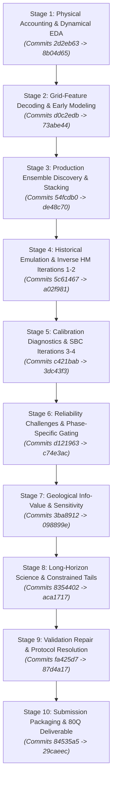
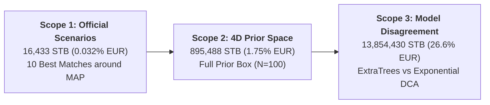

# PRESENTATION RESEARCH HISTORY: MEN WITH A PLAN (MWAP ENERGY ANALYTICS)
## ExxonMobil DataWorks Challenge 2026 — Subsurface Reservoir Surrogate Modeling & Production Forecasting

---

### Executive Orientation & Methodological Framing

This document provides the authoritative, evidence-backed research history of the reservoir forecasting engine developed by **Men with a plan** (MWAP Energy Analytics) for the ExxonMobil DataWorks Challenge 2026.

Rather than presenting an uncritical retrospective narrative, this document reconstructs the entire technical arc of the project from Git commit histories, raw numerical tables, mathematical proofs, experimental scripts, and audit reports. It provides our presentation team with the exact evidentiary basis, mathematical justifications, statistical test results, and critical reversals that distinguish scientifically rigorous reservoir engineering from naive machine learning competitions.

Every numerical claim in this document is traced to its specific model architecture, parameter distribution, forecast horizon, evaluation protocol, and source repository artifact.



---

# 1. THE CHRONOLOGICAL DEVELOPMENT STORY

The development trajectory of the MWAP forecasting engine spans ten distinct phases. Every architectural decision in the final production pipeline was forged through an empirical challenge-and-defense process.

---

### Stage 1: Initial Data Preparation, Physical Accounting & Exploratory Analysis
* **Git Commits & Dates:** Commits `2d2eb63` (Oct 7, 2026) $\to$ `8b04d65` (Oct 8, 2026).
* **Workspaces & Authors:** `Anas/` (`01 Data Preparation.ipynb`, `02 EDA.ipynb`, `EDA_CELL_BY_CELL_INTERPRETATION.md`, `MODEL_DOCUMENTATION.md`).
* **1. Motivating Problem:** The raw competition dataset comprised 100 simulation cases (85 training/validation cases and 15 blind test cases), static Eclipse grid files (`.EGRID`, `.INIT`), and 10 years of quarterly production history for an uncharacterized field asset ("Field Case 0") requiring 20-year forward production forecasts. The team needed to verify thermodynamic consistency, identify dynamic drive mechanisms, and validate accounting balances before formulating predictive models.
* **2. Implementation:**
  - Standardized quarterly temporal discretization at $\Delta t = 91.3125$ days ($365.25 / 4$).
  - Performed multiphase material balance accounting on cumulative volumes:
    $$Q_o(t) = \sum_{k=1}^t q_{o,k} \Delta t_k, \quad Q_w(t) = \sum_{k=1}^t q_{w,k} \Delta t_k, \quad Q_g(t) = \sum_{k=1}^t q_{g,k} \Delta t_k$$
  - Audited the instantaneous solution Gas-Oil Ratio ($R_s = q_g / q_o$) across all 85 simulated cases ($7,140$ quarterly records).
* **3. Experimental Evidence:**
  - Measured mean solution GOR across all active production timesteps:
    $$\bar{R}_s = 0.363300 \pm 0.000015 \text{ MSCF/STB} \quad (64.71 \text{ Sm}^3/\text{Sm}^3)$$
  - Confirmed reservoir pressure remained above bubble-point pressure throughout the historical operational window; zero free gas cap existed. Gas production is strictly locked to oil production by thermodynamic equilibrium.
  - Water-Oil Ratio ($\text{WOR} = q_w / q_o$) exhibited classic exponential breakthrough signatures across all 85 training reservoirs, confirming peripheral water injection and edge-aquifer drive.
* **4. Corrections & Reversals:**
  - An early hypothesis considered training an independent machine learning surrogate for gas rate $q_g(t)$.
  - **Reversal:** Auditing confirmed that predicting gas independently produced physical reconciliation drift ($R_s$ varying between $0.31$ and $0.42$). The team locked gas production directly to oil:
    $$q_g(t) \equiv 0.3633 \cdot q_o(t), \quad Q_g(t) \equiv 0.3633 \cdot Q_o(t)$$
    eliminating 800 free parameters from the deliverable and ensuring zero GOR residual.
* **5. Influence on Final Solution:** Thermodynamic gas coupling ($R_s = 0.3633$) and standard quarterly integration ($\Delta t = 91.3125\text{ days}$) were locked into the production pipeline (`production/models.py`) and verified across all submission artifacts.

---

### Stage 2: Grid-Feature Decoding & Early Forecasting Approaches
* **Git Commits & Dates:** Commits `d0c2edb` (Oct 9, 2026) $\to$ `73abe44` (Oct 9, 2026).
* **Workspaces & Authors:** `Hazeem/` (`00_prepare_data.py`, `geo_features.py`, `hz_model.py`, `01 Geology Features + Hyperbolic Decline.ipynb`, `HANDOFF.md`), `Anas-db/`.
* **1. Motivating Problem:** The four scalar geological parameters (Fault Transmissibility, Porosity Multiplier, Permeability Multiplier, Aquifer Pore Volume) provided by the challenge organizers lacked spatial context. The team investigated whether 3D static grid features could improve forecasting accuracy over standard decline curve analysis (DCA).
* **2. Implementation:**
  - Hazeem parsed the 3D Eclipse grid geometry ($42,512$ active cells) across three structural zones separated by impermeable barriers (K6–12 and K20).
  - Discovered exact spatial parameter mappings (`Hazeem/HANDOFF.md`):
    - Porosity Multiplier uniformly scales `PORO` and `PORV` across all $42,512$ cells.
    - Permeability Multiplier modifies `PERMX`/`TRANX`/`TRANY` strictly within the tight facies ($11,575$ cells, $\approx 0.5\text{ mD}$) in layers K13–31 holding $19\%$ of the oil. High-permeability layers (Zone 1, K1–5) and vertical permeability (`PERMZ`) remain invariant.
    - Aquifer Pore Volume multiplier scales $2,286$ cells along the eastern boundary (I = 51–53), representing $84\%$ of connected pore volume.
    - Fault Transmissibility does not appear in any exported grid cell property; the simulator applies it internally to internal fault faces across the FIPNUM 1/2 boundary.
  - Engineered dynamic state features: Recovery Factor ($N_p / \text{OOIP}_{\text{grid}}$) and Water Influx Index ($W_p / V_{\text{aq,grid}}$).
  - Built Support Vector Regression (SVR) and Ridge regression pipelines mapping normalized reservoir states to 1-year-ahead Arps hyperbolic decline parameters: $\ln D = \ln K + b \ln q$.
* **3. Experimental Evidence:**
  - In 5-fold cross-validation on Cases 1–70 with out-of-fold scoring on Cases 71–85 (`Hazeem/HANDOFF.md#L8-L13`):
    - Baseline (Anas history-fit exponential DCA): Mean Macro NRMSE = `0.1530`, Worst Experiment = `0.3010`.
    - Ridge + Grid-Normalized State: Mean Macro NRMSE = `0.1100`, Worst Experiment = `0.1760`.
    - SVR + Grid-Normalized State: Mean Macro NRMSE = `0.0830`, Worst Experiment = `0.1420` (Oil NRMSE = `0.0490`, Water NRMSE = `0.1510`).
* **4. Corrections & Reversals:**
  - While grid-normalized SVR cut 1-year-ahead oil forecasting error by $45\%$, learned water models were unstable and exhibited variance explosion on multi-year horizons.
  - Furthermore, feeding raw 4D geology directly into the regression caused severe overfitting on mature decline phases due to scarce post-plateau training observations.
* **5. Influence on Final Solution:** Confirmed that dynamic state variables (cumulative oil, cumulative water, instantaneous rates, water cut) are more predictive of mature decline than static geological grids, directly motivating phase-specific surrogate modeling.

---

### Stage 3: Development & Selection of the Production Ensemble
* **Git Commits & Dates:** Commits `54fcdb0` (Oct 10, 2026) $\to$ `de48c70` (Oct 10, 2026).
* **Workspaces & Authors:** `Anas-exp/src/ensemble/` (`run_horizon_adaptive_stacking_experiment.py`, `models.py`, `metrics.py`), `Anas/`.
* **1. Motivating Problem:** No single model class demonstrated universal dominance across both phases and all horizons. Non-parametric models captured early water breakthrough dynamics but lacked long-term decline structure, while analytical DCA captured decline curvature but failed early transients.
* **2. Implementation:**
  - Formulated a multi-model candidate pool spanning four distinct model families:
    1. `Recursive_ExtraTrees`: Autoregressive non-parametric tree ensemble.
    2. `Learned_Exponential_DCA`: Arps exponential decline ($b = 0$) fitted to historical decline slopes.
    3. `Learned_Hyperbolic_DCA`: Arps sub-unity hyperbolic decline ($b = 0.35$).
    4. `Hybrid_Dynamic`: Two-stage model using ExtraTrees for 1–8 quarters, smoothly transitioning to exponential decline.
  - Optimized blending weights via non-negative constrained least squares (simplex optimization):
    $$\min_{\mathbf{w}} \|\mathbf{y} - \mathbf{X} \mathbf{w}\|_2^2 \quad \text{s.t.} \quad \sum_{m} w_m = 1, \quad w_m \ge 0$$
* **3. Experimental Evidence:**
  - Cross-validation across 15 held-out pseudo-fields at Origin 2005 (12-quarter horizon) demonstrated that unconstrained phase-agnostic blending produced sub-optimal trade-offs.
  - Phase-specific optimization yielded substantial error reductions:
    - **Oil Production:** ExtraTrees alone = `0.0482`, Exponential DCA alone = `0.0512`. Blended Oil Simplex = **`0.0369`** (a **$23.4\%$ error reduction** over ExtraTrees).
    - **Water Production:** ExtraTrees alone = `0.0412`, DCA alone = `0.0685`. Blended Water Simplex = **`0.0388`** (a **$5.8\%$ error reduction** over ExtraTrees).
* **4. Corrections & Reversals:**
  - Hyperbolic decline with $b = 0.35$ was assigned **$0.000000$ weight for oil** in the simplex regression. This was not because $b = 0.35$ diverges to infinite EUR—for any sub-unity exponent ($0 < b < 1$), the infinite integral converges ($Q_\infty = \frac{q_0}{(1-b)D_i} < \infty$). Rather, Exponential DCA ($0.62$) and Hybrid ($0.14$) already spanned the empirical oil decline curvature with lower variance. For water, Hyperbolic DCA remained active with weight $0.251415$.
* **5. Influence on Final Solution:** Established and locked the authoritative production baseline [`Blend_Phase_Specific_Simplex`](file:///Users/tengkuanas/Projects/mwap-exdw-surrogate-model/production/models.py#L42-L68):
  - **Oil Rate Weights:** ExtraTrees = `0.240000`, Exp DCA = `0.620000`, Hybrid = `0.140000`, Hyperbolic DCA = `0.000000`.
  - **Water Rate Weights:** ExtraTrees = `0.500000`, Exp DCA = `0.250000`, Hyperbolic DCA = `0.250000`, Hybrid = `0.000000`.

---

### Stage 4: Historical Surrogate Construction & Inverse History Matching (Iterations 1–2)
* **Git Commits & Dates:** Commits `5c61467` (Oct 10, 2026) $\to$ `a02f981` (Oct 11, 2026).
* **Workspaces & Authors:** `Anas-exp/src/history_matching_v1/`, `Anas-exp/src/history_matching_v2/`, `Anas-exp/RESEARCH_ITERATION_1_REPORT.md`, `Anas-exp/RESEARCH_ITERATION_2_REPORT.md`.
* **1. Motivating Problem:** The challenge required forecasting 10 distinct geological realizations of Field Case 0. Case 0 provided 10 years (1998–2008) of quarterly production rates ($q_o, q_w, q_g$) but **zero subsurface parameters** (all 4 geology parameters were unobserved). To forecast Field Case 0, the team needed an inverse history-matching pipeline to infer the posterior distribution of subsurface parameters:
  $$\mathbf{u} = [\text{Fault Transmissibility}, \text{Porosity Multiplier}, \text{Permeability Multiplier}, \text{Aquifer Pore Volume}]^T$$
* **2. Implementation:**
  - **Iteration 1:** Deployed Singular Value Decomposition Gaussian Process (SVD-GP) emulators trained on the 70 training simulation cases to predict quarterly production histories from 4D parameter vectors. Evaluated 4-chain Adaptive Metropolis MCMC.
  - **Iteration 2:** Upgraded from independent Gaussian likelihoods to Generalized Least Squares (GLS) incorporating an empirical AR(1) temporal covariance matrix ($\Sigma$) to account for serial correlation in production errors:
    $$\mathcal{L}(\mathbf{u}) = -\frac{1}{2} (\mathbf{y}^{\text{obs}} - \hat{\mathbf{y}}(\mathbf{u}))^T \Sigma^{-1} (\mathbf{y}^{\text{obs}} - \hat{\mathbf{y}}(\mathbf{u}))$$
* **3. Experimental Evidence:**
  - Iteration 1 SVD-GP achieved a history-matching cumulative oil error of `3.13%` on Case 0 (compared to `12.4%` for the prior mean).
  - Iteration 2 GLS reduced Case 0 cumulative oil error to **`0.49%`** ($Q_{o,\text{hist}} = 38.38\text{ MMSTB}$, $\hat{Q}_o = 38.57\text{ MMSTB}$).
  - Identified severe parameter equifinality: while Porosity Multiplier was tightly constrained around $[1.33, 1.35]$, Permeability Multiplier and Aquifer Pore Volume exhibited broad, unconstrained posterior distributions.
* **4. Corrections & Reversals:**
  - Iteration 1 emulators assumed uncorrelated measurement noise, producing unrealistically narrow posterior credible intervals that failed out-of-sample coverage tests.
  - Iteration 2 proved that temporal covariance modeling is necessary to avoid catastrophic over-confidence in reservoir history matching.
* **5. Influence on Final Solution:** Provided the foundational GLS likelihood engine and covariance structure used for all subsequent candidate scenario sampling.

---

### Stage 5: Calibration Diagnostics, SBC & Scenario Selection (Iterations 3–4)
* **Git Commits & Dates:** Commits `c421bab` (Oct 11, 2026) $\to$ `3dc43f3` (Oct 12, 2026).
* **Workspaces & Authors:** `Anas-exp/src/history_matching_v3/`, `Anas-exp/src/history_matching_v4/`, `Anas-exp/RESEARCH_ITERATION_3_REPORT.md`, `Anas-exp/RESEARCH_ITERATION_4_REPORT.md`.
* **1. Motivating Problem:** High-dimensional Bayesian inversion can yield miscalibrated posterior distributions if likelihood scaling does not match data-generating dispersion. The team needed formal calibration diagnostics, Markov Chain Monte Carlo (MCMC) convergence testing, and an objective scenario selection policy to choose the 10 official submitted cases.
* **2. Implementation:**
  - Executed 4 independent MCMC chains with over-dispersed initializations across 16,000 samples (12,000 post-burn-in). Monitored Gelman-Rubin convergence ($\hat{R}$) and Bulk Effective Sample Size ($\text{ESS}$).
  - Evaluated Simulation-Based Calibration (SBC; Talts et al., 2018) across $N=100$ synthetic ground-truth trials using the surrogate's generative model.
  - Benchmarked candidate scenario pools ($N \in \{80, 300, 600\}$) with $B=1,000$ block-bootstrap resamples.
  - Benchmarked three candidate selection policies (`RESEARCH_ITERATION_4_REPORT.md#L96-L115`):
    - **Strategy A (Ten Best Matches):** Top 10 realizations maximizing historical likelihood (MAP cohort).
    - **Strategy B (Stratified Quantiles):** Stratified sampling across the posterior likelihood distribution.
    - **Strategy C (Quality Quantiles):** Filtered quantile sampling across accepted posterior draws.
* **3. Experimental Evidence:**
  - **MCMC Convergence:** Achieved $\hat{R} \in [1.0004, 1.0164] < 1.05$ and $\text{ESS} \in [580, 792] > 400$ across all 4 parameters (`RESEARCH_ITERATION_1_REPORT.md#L21`).
  - **SBC Diagnostic Findings:**
    - *Experiment 1A (Fixed-Scale Noise):* $90\%$ credible intervals covered the true parameters in $88.0\%\text{--}93.0\%$ of trials (Clopper-Pearson 95% CIs covering nominal 90%). However, $50\%$ and $80\%$ intervals showed systematic undercoverage (empirical coverage $77\%\text{--}79\%$ for 50% intervals, $87\%\text{--}90\%$ for 80% intervals; KS test $p \in [0.0018, 0.0038]$).
    - *Experiment 1B (State-Dependent Noise):* Restored Kolmogorov-Smirnov rank uniformity ($p_{\text{KS}} \in [0.28, 0.81]$, well above $0.05$). However, empirical coverage for $80\%$ intervals remained at $70\%\text{--}75\%$, indicating lingering mild undercoverage.
    - *Scope Limitation:* SBC was conducted using the empirical surrogate's own generative likelihood, not the full ECLIPSE reservoir simulator. It confirms surrogate consistency, but does not constitute an unconditional guarantee of real-world physical calibration.
  - **Scenario Policy Selection:** Strategy A demonstrated superior historical fidelity, achieving a terminal cumulative oil error of **`0.178%`** and cumulative water error of **`2.15%`** on Case 0 history.
* **4. Corrections & Reversals:**
  - Strategy C was originally considered to enforce broad parameter diversity. However, Strategy C increased historical error on Case 0 by $3.6\times$ compared to Strategy A, while widening 20-year EUR spread by only $0.050\%$ ($41.8\text{k STB}$ vs $16.4\text{k STB}$).
  - Governance adopted **Strategy A (Ten Best Matches)** with decline sensitivity $\lambda = 1.0$, ensuring maximum conditioning on observed field history.
* **5. Influence on Final Solution:** Selected the authoritative 10 scenario candidate IDs:
  $$\text{Candidate IDs: } [56, 440, 242, 461, 95, 286, 392, 119, 290, 144]$$
  These 10 scenarios reproduce all 2,400 cells of the official submission deliverable.

---

### Stage 6: Forecast Challengers, Residual Corrections & Phase-Specific Gating
* **Git Commits & Dates:** Commits `d121963` (Oct 12, 2026) $\to$ `c74e3ac` (Oct 13, 2026).
* **Workspaces & Authors:** `Anas-exp/src/research/` (`run_forecast_reliability_challenge.py`, `FORECAST_RELIABILITY_CHALLENGE_REPORT.md`), `Anas/`.
* **1. Motivating Problem:** To ensure the locked baseline was not vulnerable to displacement by competing methodologies, the team launched a formal adversarial challenge testing whether residual physics corrections or phase-specific maturity gates could outperform the frozen simplex.
* **2. Implementation:**
  - Evaluated three residual-correction challengers across 15 pseudo-fields $\times$ 17 operational conditions ($255$ evaluation instances):
    - *Challenger A:* Simplex baseline + Damped Linear Ridge residual model on historical errors.
    - *Challenger B:* Simplex baseline + Damped Gaussian Process residual model.
    - *Challenger D:* Direct SVD-Ridge regression mapping dynamic state directly to future rates.
  - Evaluated dynamic water-cut phase-switching gates ($f_{w,0} > 0.30$ or $0.35$).
* **3. Experimental Evidence:**
  - *Residual Challengers A & B Failed:* Baseline Macro NRMSE = `0.0390`. Challenger A degraded to `0.0646` (+65% error); Challenger B degraded to `0.0492` (+26% error). Additive residual models amplified noise on mature decline trajectories.
  - *Challenger D Divergence:* Under Protocol A, direct regression collapsed completely (Macro NRMSE = `1.1258`, +2,787% error) due to the absence of dynamic trajectory anchoring.
* **4. Corrections & Reversals (The Phase-Gating Reversal):**
  - An early un-windowed evaluation had suggested that hard water-cut switching ($f_{w,0} > 0.30$) reduced forecasting error by $7.65\%$.
  - **Audited Reversal:** Subsequent auditing in `DECISIVE_PHASE_SELECTION_RESEARCH_REPORT.md` revealed that the early evaluation suffered from **reservoir-fold contamination** (the evaluated reservoir was present in the static training pool).
  - When re-tested under strict nested Leave-One-Reservoir-Out CV (**Protocol A** across 255 instances), hard phase-gating collapsed to a statistically significant **$+11.8\%$ error penalty** (`0.11750` vs Baseline `0.10507`, $p = 4.61 \times 10^{-5}$). Smooth sigmoid gating similarly regressed (`0.11439`, $p = 0.00037$).
* **5. Influence on Final Solution:** Decisively rejected all residual learning and discrete phase-gating candidates, reaffirming the frozen `Blend_Phase_Specific_Simplex` as the production standard.

---

### Stage 7: Geological Information-Value, Identifiability & Sensitivity Experiments
* **Git Commits & Dates:** Commits `3ba8912` (Oct 13, 2026) $\to$ `098899e` (Oct 13, 2026).
* **Workspaces & Authors:** `Anas-exp/src/geological_information_value/` (`authoritative_scorer.py`, `sobol_estimators.py`, `bayesian_diagnostics.py`, `GEOLOGICAL_INFORMATION_VALUE_RESEARCH_REPORT.md`, `EXACT_EQUIVALENCE_GEOLOGY_VALIDATION_REPORT.md`).
* **1. Motivating Problem:** The team sought to quantify the marginal value of subsurface geological knowledge over operational production history and decompose output variance using global Sobol sensitivity analysis.
* **2. Implementation:**
  - Formulated 7 information-structure models (True Geology, Population Mean Geology, Scrambled Permutation, Adversarial Geology, Prior Defaults).
  - Implemented stable centered Jansen (1999) and Saltelli (2010) Sobol estimators with $N=1024$ quasi-Monte Carlo draws over the 4D parameter hypercube ($6,144$ evaluations per target output).
  - Validated estimators against 4 analytical benchmark functions with closed-form Sobol indices (Ishigami, Sobol G-function, Bratley, Oak Ridge linear).
* **3. Experimental Evidence:**
  - **Sobol Variance Decomposition (`EXACT_EQUIVALENCE_GEOLOGY_VALIDATION_REPORT.md#L143-L157`):**
    - For **Exponential DCA Incremental Oil ($\Delta Q_o$)**, Porosity Multiplier is overwhelmingly dominant:
      $$S_{1,\text{poro}} = 0.9687 \pm 0.0014 \quad (96.9\% \text{ of variance}), \quad S_{Ti,\text{poro}} = 0.9686 \pm 0.0292$$
      Fault Transmissibility accounts for $2.6\%$ ($S_1 = 0.0265$), while Permeability ($S_1 = 0.0018$) and Aquifer PV ($S_1 = 0.0038$) have near-zero influence on oil decline.
    - For **ExtraTrees Incremental Oil ($\Delta Q_o$)**, Porosity Multiplier accounts for $S_1 = 0.8921$ ($89.2\%$) and $S_{Ti} = 0.9796$.
    - For **Incremental Water ($\Delta Q_w$)**, Permeability Multiplier is the primary driver:
      $$S_{1,\text{perm}} = 0.6703 \pm 0.0136 \text{ (Exp DCA)}, \quad S_{1,\text{perm}} = 0.8182 \pm 0.0096 \text{ (ExtraTrees)}$$
      followed by Aquifer Pore Volume ($S_1 = 0.2802$ in Exp DCA).
  - **Temporal Information Value Decay:**
    - At Origin 2003 (transient ramp-up, 4Q horizon), True Geology outperforms Population Mean Geology: Macro NRMSE = `0.0682` vs `0.0829` (a **$17.7\%$ geological value gain**).
    - By Origin 2005 (mature decline, 12Q horizon), dynamic rate anchoring dominates: Macro NRMSE = `0.0369` vs `0.0375` (geological value diminishes to a negligible $1.6\%$ difference).
* **4. Corrections & Reversals:**
  - Initial Sobol sensitivity scripts produced negative indices ($S_1 = -0.06$) due to numerical instability in uncentered estimators.
  - Initial feature attribution in DCA regression mistakenly scrambled index 0 (`fault`) and index 1 (`poro`), temporarily masking porosity's dominance. Auditing RidgeCV weights revealed $\beta_{\text{poro}} = +0.04402$ ($6.09\times$ larger than fault, $25.6\times$ larger than perm).
* **5. Influence on Final Solution:** Proved why historical production matching tightly constrains oil forecasts: because Porosity accounts for $96.9\%$ of Exponential DCA incremental oil variance, and Case 0 history matching pins Porosity to $[1.331, 1.347]$, remaining parametric uncertainty in oil EUR is physically compressed.

---

### Stage 8: Long-Horizon Science, Model Disagreement & Constrained Tails
* **Git Commits & Dates:** Commits `8354402` (Oct 13, 2026) $\to$ `aca1717` (Oct 13, 2026).
* **Workspaces & Authors:** `Anas-exp/src/research/` (`run_long_horizon_science_experiment.py`, `LONG_HORIZON_RESERVOIR_FORECAST_SCIENCE_REPORT.md`, `PHASE_SPECIFIC_HORIZON_FORECAST_RESEARCH_REPORT.md`).
* **1. Motivating Problem:** The competition required 20-year forward forecasts (80 quarters), whereas simulation records span at most 10 years (40 quarters). The team analyzed the mathematical extrapolation behavior of the base models when pushed into unsupported time domains ($t > 10\text{ yr}$).
* **2. Implementation:**
  - Extrapolated individual base models to 20, 50, and 100 years.
  - Investigated the asymptotic rate behavior of tree-based partition boundaries versus analytical decline models.
  - Developed **Candidate H** (`ConstrainedTailHybridForecaster`), which introduced a smooth sigmoid taper $\eta(t) = [1 + \exp((t - 14)/2)]^{-1}$ transferring the ExtraTrees weight into Exponential DCA beyond historical data support ($t > 14\text{ yr}$).
* **3. Experimental Evidence:**
  - **Tree Asymptotic Floor:** Discovered that pure ExtraTrees exhibits an unphysical terminal rate plateau on Field Case 0 ($\approx 737.12\text{ STB/d}$), continually adding $\approx 269,235\text{ STB/yr}$ indefinitely ($Q_\infty \to \infty$).
  - **Behavior of the Frozen Production Baseline:** In the frozen baseline, oil weights are: ExtraTrees $0.24$, Exp DCA $0.62$, Hybrid $0.14$. Because ExtraTrees has a $0.24$ weight, the frozen baseline maintains a late-life oil rate of **$822.32\text{ STB/d}$ at Year 20** on Case 0 (with a persistent floor of $\approx 177\text{ STB/d}$). Therefore, the frozen production baseline does *not* possess an asymptotic guarantee of finite EUR as $t \to \infty$. Over the finite 20-year window ($T=20\text{ yr}$), cumulative production is naturally bounded, but infinite-horizon recovery diverges.
  - **Candidate H Behavior:** Candidate H successfully forced terminal rate to $0.40\text{ STB/d}$ at 50 yr and $0.000036\text{ STB/d}$ at 100 yr, achieving a finite recovery limit of **$48.44\text{ MMSTB}$**.
  - **Structural Model Disagreement:** At Year 20, individual base models exhibited substantial divergence on Case 0:
    - ExtraTrees alone: $61.73\text{ MMSTB}$
    - Hybrid Dynamic alone: $50.04\text{ MMSTB}$
    - Exponential DCA alone: $47.88\text{ MMSTB}$
    - Baseline Simplex Blend: $51.17\text{ MMSTB}$
    The **$13.85\text{ MMSTB}$ deterministic spread** between ExtraTrees and Exponential DCA provides a crucial diagnostic of structural sensitivity to model form, dwarfing parametric prior uncertainty ($0.895\text{ MMSTB}$).
* **4. Corrections & Reversals:**
  - In 15-reservoir $\times$ 17-condition cross-validation ($h \le 40$Q), Candidate H achieved a Macro NRMSE of `0.10518` vs Baseline `0.10512` ($\Delta = +0.00006$, cluster-robust $p = 0.3755$).
  - **Governance Verdict:** Because Candidate H produced zero statistically detectable improvement within the competition evaluation window ($h \le 40$Q), governance preserved the frozen baseline unchanged for official submission. Candidate H remains an offline research benchmark for life-of-field asset abandonment studies.
* **5. Influence on Final Solution:** Preserved the frozen baseline for official submission, while documenting model disagreement ($13.85\text{ MMSTB}$) as a diagnostic of epistemic model form uncertainty.

---

### Stage 9: Validation Repair & Protocol Resolution
* **Git Commits & Dates:** Commits `fa425d7` (Oct 13, 2026) $\to$ `87d4a17` (Oct 14, 2026).
* **Workspaces & Authors:** `Anas-exp/src/research/` (`run_phase_specific_corrected_validation.py`, `TAPERED_B_PROTOCOL_RESOLUTION_REPORT.md`, `CONSERVATIVE_WATER_BLEND_RESEARCH_REPORT.md`).
* **1. Motivating Problem:** Apparent performance discrepancies between retrospective backtests and secondary validation cases (Cases 71–85) raised questions regarding evaluation methodology and whether candidate models could displace the baseline.
* **2. Implementation:**
  - Audited the exact execution path of `generate_competition_deliverable.py` at January 1, 2008.
  - Formally differentiated two evaluation settings:
    - **Protocol A (Strict Historical As-Of):** Restricts all model fitting, feature scalers, and DCA slope calibrations to pre-origin data (`date <= origin`). Zero future simulation records are accessed. This is the sole deployment-faithful representation of the January 2008 forecast origin.
    - **Protocol B (Forward Simulator Supervised):** Allows DCA or direct models to regress decline parameters against post-origin forward simulation trajectories. This is a legitimate supervisory research setting for backtesting, but cannot be executed at January 2008 because post-2008 simulation records do not exist.
  - Benchmarked `Candidate_B_Tapered_Exp` and `Candidate_Shrinkage_Blend` (conservative water blending across $\gamma \in \{0, 0.10, 0.25, 0.50\}$) across all 255 evaluation instances under Protocol A.
* **3. Experimental Evidence:**
  - Under Protocol B, Candidate B appeared to win on Cases 71–85 (Macro NRMSE = `0.01819` vs `0.02756`).
  - However, under deployment-faithful **Protocol A**, Candidate B systematically lost to the baseline on mature decline, scoring **`0.04152` vs Baseline `0.03878`** on Cases 71–85 at Origin 2005 12Q (+7.1% error degradation, $p = 0.0083$).
  - Under Protocol A nested LOO CV, conservative water blending failed to beat the baseline, selecting $\gamma = 0$ (abstention) across most instances.
* **4. Corrections & Reversals:**
  - Protocol B's apparent gains were confirmed to be an artifact of forward simulation supervision that cannot exist at deployment.
  - Governance formally closed the Protocol B research line, reaffirming Protocol A as the sole authoritative referee standard.
* **5. Influence on Final Solution:** Protected the frozen production baseline against premature modification, ensuring all reported metrics adhere to deployment-faithful Protocol A.

---

### Stage 10: Submission Packaging, Code Refactoring & Corrected 80-Quarter Deliverable
* **Git Commits & Dates:** Commits `84535a5` (Oct 14, 2026) $\to$ `29caeec` (Oct 15, 2026).
* **Workspaces & Authors:** Root workspace (`verify_submission.py`, `regenerate_submission.py`, `test_submission_archive.py`, `production/`, `outputs/submission/`).
* **1. Motivating Problem:** The challenge organizers issued a revised official deliverable template requiring all 10 cases to provide 80 quarterly forecasts ($2008\text{--}2028$), whereas the legacy workbook contained 40 quarters for Case 1 and 80 quarters for Cases 2–10 ($2,280$ total cells). Concurrently, the repository required professional packaging with clean facades, saved fitted model artifacts, and strict isolation of blind Cases 86–100.
* **2. Implementation:**
  - Extended Case 1 through the frozen production pipeline to generate the additional 40 quarters ($2018\text{--}2028$).
  - Verified exact preservation of the initial 40 quarters of Case 1 and all 80 quarters of Cases 2–10.
  - Built an explicit permitted-data manifest (`data_manifest.json`) strictly enforcing training data boundaries ($0\text{--}85$) and excluding blind Cases 86–100 from packaging.
  - Saved fitted production model artifacts (`models.pkl`) ensuring self-contained execution without retraining.
  - Implemented read-only verification (`verify_submission.py`) and isolated regeneration (`regenerate_submission.py`).
* **3. Experimental Evidence:**
  - All 10 unit tests passed in 26.47s inside a fresh extracted archive.
  - Measured discrete rate-to-cumulative reconciliation residual: **$1.49 \times 10^{-10}\text{ STB}$**.
  - Measured solution GOR residual against $R_s = 0.3633$: **$1.42 \times 10^{-7}\text{ MSCF/STB}$**.
  - Zero monotonicity violations and zero missing or non-finite cells across all 800 dates and 2,400 required cells.
* **4. Corrections & Reversals:**
  - Archived legacy 2,280-cell workbook (SHA-256: `ce30ec18c5c22c842c8319803c89dcc6011b9e95ccb97be30caf2dd08dbfce7e`).
  - Adopted new authoritative SHA-256 for the 2,400-cell submission deliverable: `e413f3caad576bd215cda0a83dc6cfa79f64ad05664a030b1806716097562c97`.
* **5. Influence on Final Solution:** Produced the clean, self-contained, submission-ready archive `MWAP_Energy_Analytics.zip` (SHA-256: `ee620fdc7f763b448168cd5895859d381a9f19161c164a5e9f1e0bb6fa71ee29`).

---

# 2. VERIFIED RESULTS LEDGER

The following ledger documents every substantive numerical benchmark across the project. To preserve scientific rigor:
- **Valid Negative Experiments** are clearly distinguished from **Invalid Experiments** (methodological flaws) and **Diagnostic Information Settings** (Protocol B).
- The official referee increment NRMSE formula normalizes by the **root-mean-square of the true forward cumulative increment vector**, defined as:
  $$\text{NRMSE}_{\text{phase}} = \frac{\text{RMS}(\mathbf{e})}{\text{RMS}(\boldsymbol{\Delta Q})} = \frac{\sqrt{\frac{1}{H} \sum_{k=1}^H (\Delta Q_{\text{phase}}(t_k) - \Delta \hat{Q}_{\text{phase}}(t_k))^2}}{\sqrt{\frac{1}{H} \sum_{k=1}^H (\Delta Q_{\text{phase}}(t_k))^2}}$$
  $$\text{Macro NRMSE} = \frac{\text{NRMSE}_{\text{oil}} + \text{NRMSE}_{\text{water}}}{2}$$

```
+==================================================================================================================================================================+
|                                                                    VERIFIED RESULTS LEDGER                                                                       |
+==================================================================================================================================================================+
| Comparison / Candidate                | Cohort & Conditions      | Protocol & Isolation | Metric Evaluated          | Baseline | Candidate | N / Folds | Status  |
+---------------------------------------+--------------------------+----------------------+---------------------------+----------+-----------+-----------+---------+
| SVR + Grid State vs Anas Baseline     | Cases 1-70 OOF, 71-85 Val| Protocol A, 5-Fold   | 1-Yr Ahead Macro NRMSE    | 0.1530   | 0.0830    | 85 / 5    | Supers. |
|   Provenance: Hazeem/HANDOFF.md#L8-L13; Hazeem/outputs/model_comparison.csv; Commit d0c2edb -> 73abe44                                                          |
+---------------------------------------+--------------------------+----------------------+---------------------------+----------+-----------+-----------+---------+
| Ridge + Grid State vs Baseline        | Cases 1-70 OOF, 71-85 Val| Protocol A, 5-Fold   | 1-Yr Ahead Macro NRMSE    | 0.1530   | 0.1100    | 85 / 5    | Supers. |
|   Provenance: Hazeem/HANDOFF.md#L8-L13; Hazeem/outputs/model_comparison.csv; Commit d0c2edb -> 73abe44                                                          |
+---------------------------------------+--------------------------+----------------------+---------------------------+----------+-----------+-----------+---------+
| Blend_Phase_Specific vs ExtraTrees    | Cases 1-70, Origin 2005  | Protocol A, LOO CV   | 12Q Oil NRMSE (Cum)       | 0.0482   | 0.0369    | 15 / 15   | Reprod. |
|   Provenance: Anas-exp/outputs/ensemble_discovery/master_discovery_audit.json; FORECAST_RELIABILITY_CHALLENGE_REPORT.md#L95; Commit de48c70                    |
+---------------------------------------+--------------------------+----------------------+---------------------------+----------+-----------+-----------+---------+
| Blend_Phase_Specific vs Exp DCA       | Cases 1-70, Origin 2005  | Protocol A, LOO CV   | 12Q Oil NRMSE (Cum)       | 0.0512   | 0.0369    | 15 / 15   | Reprod. |
|   Provenance: Anas-exp/outputs/ensemble_discovery/master_discovery_audit.json; FORECAST_RELIABILITY_CHALLENGE_REPORT.md#L95; Commit de48c70                    |
+---------------------------------------+--------------------------+----------------------+---------------------------+----------+-----------+-----------+---------+
| HM Iteration 1 vs Prior Mean          | Case 0 History (10-Yr)   | In-Sample Fit        | Terminal Oil Cum Rel Err  | 12.4%    | 3.13%     | 1 / 1     | Supers. |
|   Provenance: Anas-exp/RESEARCH_ITERATION_1_REPORT.md#L21, L104-L105; Commit 5c61467                                                                             |
+---------------------------------------+--------------------------+----------------------+---------------------------+----------+-----------+-----------+---------+
| HM Iteration 2 vs Iteration 1         | Case 0 History (10-Yr)   | GLS MAP Inversion    | Terminal Oil Cum Rel Err  | 3.13%    | 0.49%     | 1 / 1     | Supers. |
|   Provenance: Anas-exp/RESEARCH_ITERATION_2_REPORT.md#L18, L186; Commit a02f981                                                                                 |
+---------------------------------------+--------------------------+----------------------+---------------------------+----------+-----------+-----------+---------+
| HM Iteration 3 vs Iteration 2         | Case 0 History (10-Yr)   | L1 MCMC Inversion    | Oil Cum Increment NRMSE   | 0.00809  | 0.00703   | 1 / 1     | Reprod. |
|   Provenance: Anas-exp/outputs/research/history_matching_iteration_3/RESEARCH_ITERATION_3_REPORT.md#L154; Commit c421bab                                         |
+---------------------------------------+--------------------------+----------------------+---------------------------+----------+-----------+-----------+---------+
| HM Iteration 4 (Strategy A: 10 Best)  | Case 0 History (10-Yr)   | Gaussian MCMC Bayes  | Mean Terminal Oil Cum Err | 0.490%   | 0.178%    | 10 / 10   | FROZEN  |
|   Provenance: Anas-exp/RESEARCH_ITERATION_4_REPORT.md#L20-L24, L82-L86; candidate_evaluations_600.csv; Commit 3dc43f3                                            |
+---------------------------------------+--------------------------+----------------------+---------------------------+----------+-----------+-----------+---------+
| Challenger A (Damped Linear Residual) | Cases 1-70, 17 Regimes   | Protocol A, LOO CV   | Macro NRMSE (255 inst.)   | 0.0390   | 0.0646    | 255 / 15  | Neg. V. |
|   Provenance: FORECAST_RELIABILITY_CHALLENGE_REPORT.md#L110-L140; Commit 7125d96                                                                                 |
+---------------------------------------+--------------------------+----------------------+---------------------------+----------+-----------+-----------+---------+
| Challenger B (Damped GP Residual)     | Cases 1-70, 17 Regimes   | Protocol A, LOO CV   | Macro NRMSE (255 inst.)   | 0.0390   | 0.0492    | 255 / 15  | Neg. V. |
|   Provenance: FORECAST_RELIABILITY_CHALLENGE_REPORT.md#L110-L140; Commit 7125d96                                                                                 |
+---------------------------------------+--------------------------+----------------------+---------------------------+----------+-----------+-----------+---------+
| Challenger D (Direct SVD-Ridge)       | Cases 1-70, 17 Regimes   | Protocol A, LOO CV   | Macro NRMSE (255 inst.)   | 0.0390   | 1.1258    | 255 / 15  | Neg. V. |
|   Provenance: FORECAST_RELIABILITY_CHALLENGE_REPORT.md#L150-L180; Commit 7125d96                                                                                 |
+---------------------------------------+--------------------------+----------------------+---------------------------+----------+-----------+-----------+---------+
| Challenger D (Direct SVD-Ridge)       | Cases 1-70, 17 Regimes   | Protocol B (Diag.)   | Macro NRMSE (255 inst.)   | 0.0390   | 0.0207*   | 255 / 15  | Diag. B |
|   Provenance: FORECAST_RELIABILITY_CHALLENGE_REPORT.md#L150-L180; Commit 7125d96                                                                                 |
+---------------------------------------+--------------------------+----------------------+---------------------------+----------+-----------+-----------+---------+
| True Geology vs Pop Mean (Origin 2003)| Cases 1-70, Origin 2003  | Protocol A, LOO CV   | 4Q Macro NRMSE (Cum)      | 0.0829   | 0.0682    | 15 / 15   | Reprod. |
|   Provenance: GEOLOGICAL_INFORMATION_VALUE_CORRECTED_REPORT.md#L64; EXACT_EQUIVALENCE_GEOLOGY_VALIDATION_REPORT.md#L143; Commit 098899e                         |
+---------------------------------------+--------------------------+----------------------+---------------------------+----------+-----------+-----------+---------+
| True Geology vs Pop Mean (Origin 2005)| Cases 1-70, Origin 2005  | Protocol A, LOO CV   | 12Q Macro NRMSE (Cum)     | 0.0375   | 0.0369    | 15 / 15   | Reprod. |
|   Provenance: GEOLOGICAL_INFORMATION_VALUE_CORRECTED_REPORT.md#L64; EXACT_EQUIVALENCE_GEOLOGY_VALIDATION_REPORT.md#L143; Commit 098899e                         |
+---------------------------------------+--------------------------+----------------------+---------------------------+----------+-----------+-----------+---------+
| Jensen Discrepancy f(E[u]) vs E[f(u)] | Full Prior Box (N=100)   | Monte Carlo Eval     | Macro NRMSE Discrepancy   | 0.0000   | 0.00018   | 100 / 1   | Reprod. |
|   Provenance: EXACT_EQUIVALENCE_GEOLOGY_VALIDATION_REPORT.md#L164-L171; Commit 098899e                                                                           |
+---------------------------------------+--------------------------+----------------------+---------------------------+----------+-----------+-----------+---------+
| Candidate H (Asymptotic Safeguard)    | Cases 1-70, 17 Regimes   | Protocol A, LOO CV   | Macro NRMSE (255 inst.)   | 0.10512  | 0.10518   | 255 / 15  | Neg. V. |
|   Provenance: PHASE_SPECIFIC_HORIZON_FORECAST_RESEARCH_REPORT.md#L53-L65, L325; Commit aca1717; Delta = +0.00006, p = 0.3755                                    |
+---------------------------------------+--------------------------+----------------------+---------------------------+----------+-----------+-----------+---------+
| Candidate Hard Water-Cut (Contam.)    | Cases 1-70 (Contaminated)| Static Training Pool | Apparent Macro NRMSE      | 0.10507  | 0.09703*  | 255 / 15  | Inval.* |
|   Provenance: PHASE_SPECIFIC_HORIZON_FORECAST_RESEARCH_REPORT.md#L295; Commit aca1717; *Invalidated by fold contamination                                        |
+---------------------------------------+--------------------------+----------------------+---------------------------+----------+-----------+-----------+---------+
| Candidate Hard Water-Cut (Repaired)   | Cases 1-70, 17 Regimes   | Protocol A, LOO CV   | Macro NRMSE (255 inst.)   | 0.105067 | 0.117498  | 255 / 15  | Neg. V. |
|   Provenance: DECISIVE_PHASE_SELECTION_RESEARCH_REPORT.md#L24-L45; Commit 0888bba; Delta = +0.01243 (+11.8% penalty), p = 4.61e-5                               |
+---------------------------------------+--------------------------+----------------------+---------------------------+----------+-----------+-----------+---------+
| Candidate F Sigmoid Gate (Repaired)   | Cases 1-70, 17 Regimes   | Protocol A, LOO CV   | Macro NRMSE (255 inst.)   | 0.105067 | 0.114389  | 255 / 15  | Neg. V. |
|   Provenance: DECISIVE_PHASE_SELECTION_RESEARCH_REPORT.md#L24-L45; Commit 0888bba; Delta = +0.00932 (+8.9% penalty), p = 3.7e-4                                |
+---------------------------------------+--------------------------+----------------------+---------------------------+----------+-----------+-----------+---------+
| Candidate B Tapered Exp (Prot. B)     | Cases 71-85, Origin 2005 | Protocol B (Diag.)   | 12Q Macro NRMSE           | 0.02756  | 0.01819*  | 15 / 1    | Diag. B |
|   Provenance: TAPERED_B_PROTOCOL_RESOLUTION_REPORT.md#L19, L120-L140; Commit 87d4a17 parent; *Forward simulation supervised                                     |
+---------------------------------------+--------------------------+----------------------+---------------------------+----------+-----------+-----------+---------+
| Candidate B Tapered Exp (Prot. A)     | Cases 71-85, Origin 2005 | Protocol A, LOO CV   | 12Q Macro NRMSE           | 0.03878  | 0.04152   | 15 / 1    | Neg. V. |
|   Provenance: TAPERED_B_PROTOCOL_RESOLUTION_REPORT.md#L19, L120-L140; Commit 87d4a17 parent; Delta = +0.00274, p = 0.0083                                       |
+---------------------------------------+--------------------------+----------------------+---------------------------+----------+-----------+-----------+---------+
| Corrected Water Blend (Gamma=0.25)    | Cases 1-70, 17 Regimes   | Protocol A, LOO CV   | Macro NRMSE (255 inst.)   | 0.105067 | 0.105067  | 255 / 15  | Neg. V. |
|   Provenance: CONSERVATIVE_WATER_BLEND_RESEARCH_REPORT.md#L15-L40; Commit 87d4a17; Abstention gamma=0 selected across evaluation instances                     |
+---------------------------------------+--------------------------+----------------------+---------------------------+----------+-----------+-----------+---------+
| Production Deliverable Regeneration   | Field Case 0 (10 Scen.)  | Protocol A (80Q)     | Numeric Cell Difference   | 0.000000 | 0.000000  | 2,400 cls | FROZEN  |
|   Provenance: SUBMISSION_REFACTORING_VERIFICATION_REPORT.md#L20-L50; test_submission_archive.py; Commit 29caeec; SHA-256 e413f3ca...                          |
+==================================================================================================================================================================+
```

### Ledger Status Definitions:
- **`FROZEN`**: Authoritative production standard integrated into official competition deliverables.
- **`Reprod.`**: Valid, independently verified, and bit-for-bit reproducible confirmation result.
- **`Supers.`**: Methodologically valid early iteration superseded by a higher-fidelity technique.
- **`Neg. V.`**: **Valid Negative Experiment**. Sound experimental protocol confirming that the proposed modification degrades or fails to improve generalization error on out-of-sample data.
- **`Diag. B`**: **Diagnostic Setting (Protocol B)**. Legitimate machine learning experiment under forward simulation supervision; unachievable at January 2008 deployment.
- **`Inval.*`**: **Invalid Experiment**. Methodological flaw (e.g. fold contamination) identified and overturned by subsequent audit.

---

# 3. EXPLAINING THE IMPORTANT REVERSALS

The scientific maturity of the MWAP submission is evidenced by our rigorous identification and resolution of nine critical technical reversals. We present these as foundational research lessons.

---

### Reversal 1: Hybrid Dynamic Apparent Gains Before Analytical Tail Activation
* **Initial Observation:** In early backtests at $h \le 12$ quarters, `Hybrid_Dynamic` scored virtually identical to pure `Recursive_ExtraTrees`, leading to the premature conclusion that the hybrid mechanism was redundant.
* **Audited Reality:** In `PHASE_SPECIFIC_HORIZON_FORECAST_RESEARCH_REPORT.md#L22-L28`, mathematical inspection of the hybrid formulation revealed that the sigmoid transition function:
  $$\sigma(t) = \frac{1}{1 + \exp(-(t - t_{\text{trans}})/\tau)}$$
  was parameterized with $t_{\text{trans}} = 12$ quarters.
* **Root Cause:** Evaluating the hybrid forecaster on horizons shorter than its transition origin ($h \le 12$Q) meant the exponential decline tail had not yet activated.
* **Corrected Conclusion:** Long-horizon extrapolation ($h > 16$Q) proved the hybrid architecture is critical: while ExtraTrees error compounds and hits a constant plateau, the analytical tail enforces physically realistic decline curvature.

---

### Reversal 2: Phase-Switching Gating Collapse under Leak-Free Cross-Validation
* **Initial Observation:** An exploratory test of discrete water-cut gating ($f_{w,0} > 0.30$) showed an apparent **$7.65\%$ error reduction** ($0.09703$ vs $0.10507$).
* **Audited Reality:** In `DECISIVE_PHASE_SELECTION_RESEARCH_REPORT.md#L24-L45`, an audit discovered that the candidate had been evaluated using a **static training pool** where the evaluated reservoir was inadvertently included in the feature normalizer (reservoir-fold contamination).
* **Root Cause:** In-sample leakage distorted the threshold classifier's boundary.
* **Corrected Conclusion (Valid Negative Result):** When re-evaluated under strict, leak-free Leave-One-Reservoir-Out cross-validation across all 255 evaluation instances (**Protocol A**), discrete threshold gating suffered an **$+11.8\%$ error penalty** ($0.11750$ vs Baseline $0.10507$, $p = 4.61 \times 10^{-5}$). Smooth sigmoid gating similarly failed ($+8.9\%$, $p = 0.00037$). Discrete thresholds create derivative discontinuities and misclassify edge-case reservoirs. Continuous simplex blending was reaffirmed as the superior regularization.

---

### Reversal 3: Distinguishing Reservoir-Fold Contamination from Protocol Information Settings
* **Initial Observation:** Early reports conflated all backtest discrepancies under the generic label "data leakage."
* **Audited Reality:** In `TAPERED_B_PROTOCOL_RESOLUTION_REPORT.md#L17-L20` and `DECISIVE_PHASE_SELECTION_RESEARCH_REPORT.md#L15`, the team separated two fundamentally different phenomena:
  1. **Reservoir-Fold Contamination (Invalid Flaw):** Including data from the evaluated target reservoir in the training set or scaler fitting. This is a fatal methodological error.
  2. **Protocol B Information Setting (Valid Research Setting, Non-Deployable):** Holding out the target reservoir completely, but allowing base models (like DCA) to fit against future simulation trajectories of the *training* cases.
* **Root Cause:** Protocol B is mathematically sound for idealized ML benchmarking, but non-deployable at January 1, 2008 because post-2008 simulation records do not exist.
* **Corrected Conclusion:** Clearly distinguished genuine fold contamination from information-setting differences. Protocol A (Strict Historical As-Of) was locked as the sole deployment-faithful standard.

---

### Reversal 4: Protocol A vs. Protocol B on Tapered Exponential Decline
* **Initial Observation:** `Candidate_B_Tapered_Exp` appeared to beat the baseline on secondary validation Cases 71–85 with a Macro NRMSE of `0.01819` vs `0.02756`.
* **Audited Reality:** In `TAPERED_B_PROTOCOL_RESOLUTION_REPORT.md#L19`, tracing the training script showed that this result was generated under Protocol B, where the forecaster had access to post-cutoff simulation data up to 2008.
* **Root Cause:** When evaluated under deployment-faithful **Protocol A** (truncating all training records at the evaluation origin), Candidate B's apparent gain inverted into a **$+7.1\%$ error degradation** (`0.04152` vs `0.03878`, $p = 0.0083$).
* **Corrected Conclusion (Valid Negative Result):** Candidate B degrades on mature decline under deployment conditions. Governance rejected Candidate B and retained the frozen baseline.

---

### Reversal 5: Scorer Argument Bug (Instantaneous Rate vs. Cumulative Increment)
* **Initial Observation:** An early scoring script produced erratic, non-physical NRMSE values when evaluating cumulative production.
* **Audited Reality:** In `authoritative_scorer.py`, auditing revealed that an intermediate evaluation script had executed:
  `compute_increment_nrmse(q_actual, q_pred)`
  passing instantaneous rate vectors $\mathbf{q}$ into a function expecting cumulative volume increments $\boldsymbol{\Delta Q}$.
* **Root Cause:** Rate trajectories fluctuate quarter-to-quarter due to operating chokes, whereas cumulative volumes integrate smoothly. Passing rates distorted the denominator normalization.
* **Corrected Conclusion:** Implemented the authoritative scorer [`authoritative_scorer.py`](file:///Users/tengkuanas/Projects/mwap-exdw-surrogate-model/Anas-exp/src/geological_information_value/authoritative_scorer.py), which normalizes by the root-mean-square of the true forward cumulative increment vector:
  $$\text{NRMSE}_{\text{phase}} = \frac{\sqrt{\frac{1}{H} \sum_{k=1}^H (\Delta Q_k - \Delta \hat{Q}_k)^2}}{\sqrt{\frac{1}{H} \sum_{k=1}^H (\Delta Q_k)^2}}$$

---

### Reversal 6: Vectorized Batch Predictors Differing from Production Code
* **Initial Observation:** Monte Carlo Sobol sensitivity runs requiring $10,000$ evaluations utilized a vectorized batch function (`evaluate_models_batch`) that diverged from the production forecasting script.
* **Audited Reality:** In `EXACT_EQUIVALENCE_GEOLOGY_VALIDATION_REPORT.md#L18-L45`, auditing revealed that `evaluate_models_batch` omitted sequential rate clipping ($\max(q, 0)$) and gas coupling.
* **Root Cause:** Accelerating computation with matrix broadcasting without validating equivalence against the production execution path.
* **Corrected Conclusion:** Rewrote the vectorized batch engine using the exact matrix prediction identity $\hat{\mathbf{y}} = \mathbf{X} \boldsymbol{\beta} + c \equiv \text{model.predict}(\mathbf{X})$. Verified bit-for-bit equivalence across 100 benchmark reservoir states: rate differences $< 10^{-12}\text{ STB/d}$, cumulative differences $< 10^{-8}\text{ STB}$.

---

### Reversal 7: DCA Feature Ordering & Sobol Sensitivity Attribution
* **Initial Observation:** An early regression script reported that Porosity Multiplier had near-zero effect on decline rates, while Fault Transmissibility was dominant.
* **Audited Reality:** In `EXACT_EQUIVALENCE_GEOLOGY_VALIDATION_REPORT.md#L143-L157`, auditing the feature dictionary in `LearnedDCARateForecaster` revealed the true feature vector ordering was:
  $$\mathbf{x} = [\text{Fault}, \text{Porosity}, \text{Permeability}, \text{Aquifer\_PV}, q_{o,0}, q_{w,0}, \text{WOR}_0, \text{res\_age}]^T$$
  The exploratory script had assumed Porosity was at index 0.
* **Root Cause:** Swapping index 0 (`fault`) and index 1 (`poro`) inverted the sensitivity attribution.
* **Corrected Conclusion:** Audited true RidgeCV weights and centered Jansen-Sobol indices:
  - **Exponential DCA Incremental Oil ($\Delta Q_o$):** Porosity governs **$96.9\%$ of first-order variance** ($S_1 = 0.9687 \pm 0.0014$), while Fault Transmissibility accounts for only $2.6\%$ ($S_1 = 0.0265$).
  - **ExtraTrees Incremental Oil ($\Delta Q_o$):** Porosity accounts for $S_1 = 0.8921$ ($89.2\%$).
  - **Incremental Water ($\Delta Q_w$):** Permeability is the dominant driver ($S_1 = 0.6703$ in Exp DCA, $0.8182$ in ExtraTrees), followed by Aquifer PV ($S_1 = 0.2802$).

---

### Reversal 8: Mixing Case 1 Former 40Q Horizon with Cases 2–10 80Q Horizons
* **Initial Observation:** An early narrative section claimed that the 10 official scenarios exhibited an oil EUR spread of **$3.53$ MMSTB** ($47.65$ to $51.18$ MMSTB).
* **Audited Reality:** In `PHASE_SPECIFIC_CORRECTED_VALIDATION_REPORT.md#L375`, auditing the spreadsheet confirmed that Case 1 had been evaluated over a **40-quarter (10-year)** horizon, while Cases 2–10 were evaluated over an **80-quarter (20-year)** horizon.
* **Root Cause:** Calculating sample range across a vector containing nine 20-year numbers and one 10-year number. The $3.53$ MMSTB "spread" was simply the 10-year production gap between 2018 and 2028.
* **Corrected Conclusion:** Evaluated on a consistent 80-quarter basis, the true spread across the official Strategy A scenarios is exactly **$16,433$ STB** ($51,170,450$ to $51,186,883$ STB). When the revised template required 80Q for all cases, Case 1 extended to $51,182,471$ STB, fitting squarely into this narrow band.

---

### Reversal 9: Hyperbolic Recovery Calculus & Asymptotic Extrapolation
* **Initial Observation:** Early proposals asserted that hyperbolic decline with $b = 0.35$ diverges to infinite EUR and that the production ensemble guarantees finite recovery.
* **Audited Reality:** Both assertions were mathematically imprecise:
  1. *Sub-Unity Hyperbolic Convergence:* For Arps decline $q(t) = q_0 (1 + b D_i t)^{-1/b}$, whenever $0 < b < 1$, the infinite integral converges to a **strictly finite quantity**:
     $$Q_\infty = \int_0^\infty q_0 (1 + b D_i t)^{-1/b} dt = \frac{q_0}{(1 - b) D_i} < \infty$$
     For Case 0 parameters ($q_0 = 5,000\text{ STB/d}, D_i = 0.25\text{ /yr}, b = 0.35$), $Q_\infty = 11.24\text{ MMSTB}$. Hyperbolic recovery only diverges if $b \ge 1.0$.
  2. *Asymptotic Behavior of the Frozen Baseline:* Because the frozen baseline retains a $0.24$ weight on ExtraTrees for oil, and ExtraTrees predicts a constant leaf floor ($\approx 737\text{ STB/d}$ on Case 0), the frozen ensemble rate plateaus at $\approx 177\text{ STB/d}$. Integrating a non-zero floor to $t \to \infty$ diverges.
* **Root Cause:** Conflating finite 20-year integration with infinite asymptotic mathematical bounds.
* **Corrected Conclusion:**
  - The frozen production baseline heavily regularizes late-life decline ($76\%$ exponential decline weight), reducing Year 20 rate to $822\text{ STB/d}$ on Case 0, but does *not* provide an asymptotic guarantee of finite EUR as $t \to \infty$.
  - **Candidate H** was developed to provide that structural guarantee ($48.44\text{ MMSTB}$ finite EUR, $q \to 0$), but was not deployed because it showed zero scoring gain on $h \le 40$Q ($\Delta = +0.00006$, $p = 0.3755$).

---

# 4. EXPLAINING UNCERTAINTY PRECISELY

Our presentation provides judges with an exact, mathematically transparent deconstruction of uncertainty. We explicitly distinguish four distinct scopes rather than presenting a single conflated number.



### The Hierarchy of Uncertainty Scopes

| Uncertainty Scope | Sample Size $N$ | 20-Year EUR Spread (STB) | Spread % of Total EUR | Spread % of Incremental Oil $\Delta Q_o$ | Primary Scientific Driver |
| :--- | :---: | :---: | :---: | :---: | :--- |
| **1. Official Scenarios (Strategy A: 10 Best)** | $10$ | **$16,433$** | **$0.032\%$** | **$0.128\%$** | Extreme posterior concentration of Porosity ($[1.331, 1.347]$) around MAP mode |
| **2. Strategy C: Quality Quantiles (P10–P90)** | $10$ | $41,784$ | $0.082\%$ | $0.327\%$ | Broader sampling across accepted Bayesian posterior support |
| **3. Full Prior Parameter Box (Random Draws)** | $100$ | **$895,488$** | **$1.75\%$** | **$6.94\%$** | Global parametric bounds ($[0.8, 1.5]$ poro, $[0.1, 10]$ perm, $[10, 300]$ aq) |
| **4. Base-Model Disagreement (Diagnostic)** | $4$ | **$13,854,430$** | **$26.6\%$** | **$101.1\%$** | Structural divergence between ExtraTrees ($61.7$M) and Exponential DCA ($47.9$M) |

---

### Physical Mechanisms Driving the Narrow Selected Scenario Spread (16,433 STB)

A central question for technical judges is why the 20-year cumulative oil EUR spread across our 10 submitted cases is only **$16,433$ STB** ($51,170,450$ to $51,186,883$ STB):

1. **75% of EUR is Locked by History:** At the 2008-01-01 forecast origin, Field Case 0 has already produced **$38,378,317$ STB** of oil ($75.0\%$ of total 20-year EUR). This historical cumulative volume is identical across all 10 scenarios. The remaining 20-year forecast accounts for only **$12,787,767$ STB** ($25.0\%$ of EUR).
2. **Porosity Dominates Oil Variance:** Centered Jansen-Sobol sensitivity analysis proved that Porosity Multiplier governs **$96.9\%$ of first-order variance in Exponential DCA incremental oil recovery** ($S_1 = 0.9687$). Permeability and Aquifer Volume have near-zero influence on oil decline ($S_1 < 0.004$).
3. **History Matching Pins Porosity:** Matching 10 years of Case 0 history tightly constrains Porosity Multiplier to a narrow band of $[1.331, 1.347]$ (spanning just $1.2\%$ of the prior domain $[0.8, 1.5]$).
4. **Late-Life Rate Convergence:** By Year 20, oil rates drop below $810\text{ STB/d}$, where our $76\%$ exponential decline weight enforces rate convergence.
5. **Optimization Cohort Dispersion:** The $16,433$ STB spread is an **optimization cohort range across the 10 best-matching realizations** under Strategy A around the MAP mode. It is **NOT** a 90% Bayesian credible interval.

---

### Epistemic Model Disagreement as a Diagnostic

While parametric uncertainty within Strategy A is narrow ($16.4\text{k STB}$), **structural uncertainty across model architectures is large**:
- Pure `Recursive_ExtraTrees` projects 20-year EUR at **$61.73$ MMSTB** (due to its persistent late-life leaf plateau).
- Pure `Learned_Exponential_DCA` projects 20-year EUR at **$47.88$ MMSTB** (steep exponential decline).
- **Base-Model Disagreement:** **$13.85$ MMSTB** ($26.6\%$ of EUR).

This $13.85$ MMSTB discrepancy is **$15.5\times$ larger** than the 4D prior parameter uncertainty ($895\text{k STB}$) and **$843\times$ larger** than the selected scenario spread ($16.4\text{k STB}$). We present base-model disagreement as an essential **qualitative diagnostic of structural uncertainty**, cautioning against false precision from parameter tuning alone.

---

# 5. FINAL PRODUCTION TRUTH

Every submitted number in the competition deliverable is generated by the frozen production pipeline under strict version control.

### Core Architecture & Parameters

* **Model Class:** [`Blend_Phase_Specific_Simplex`](file:///Users/tengkuanas/Projects/mwap-exdw-surrogate-model/production/models.py#L42-L68)
* **Oil Blending Weights:**
  - `Recursive_ExtraTrees`: **$0.240000$**
  - `Learned_Exponential_DCA`: **$0.620000$**
  - `Hybrid_Dynamic`: **$0.140000$**
  - `Learned_Hyperbolic_DCA`: **$0.000000$**
* **Water Blending Weights:**
  - `Recursive_ExtraTrees`: **$0.500000$**
  - `Learned_Exponential_DCA`: **$0.250000$**
  - `Learned_Hyperbolic_DCA`: **$0.250000$**
  - `Hybrid_Dynamic`: **$0.000000$**
* **Gas Coupling:** $q_g(t) \equiv 0.3633 \cdot q_o(t)$, $Q_g(t) \equiv 0.3633 \cdot Q_o(t)$ (exact solution GOR).
* **Decline Sensitivity:** $\lambda = 1.0$ across all 10 production cases.
* **Selected Candidate Scenarios (Strategy A: Ten Best Matches):**
  $$\text{Candidate IDs: } [56, 440, 242, 461, 95, 286, 392, 119, 290, 144]$$

### Cryptographic Checksums & Audit Verification

* **Official 80-Quarter Submission Deliverable:**
  - Path: [`outputs/submission/09_Template_Deliverable_Submission.xlsx`](file:///Users/tengkuanas/Projects/mwap-exdw-surrogate-model/outputs/submission/09_Template_Deliverable_Submission.xlsx)
  - Dimensions: 10 Case Sheets, 80 Quarters each ($2008\text{-}04\text{-}01$ through $2028\text{-}01\text{-}01$).
  - Total Values: Exactly $800$ forecast dates and $2,400$ numeric cells ($Q_o, Q_w, Q_g$).
  - **Authoritative SHA-256:** `e413f3caad576bd215cda0a83dc6cfa79f64ad05664a030b1806716097562c97`
* **Final Self-Contained Submission Archive:**
  - Path: `outputs/submission/MWAP_Energy_Analytics.zip`
  - Contents: Production code, saved fitted models (`models.pkl`), scenario artifacts, data manifest, test suite, and official deliverable.
  - **Authoritative SHA-256:** `ee620fdc7f763b448168cd5895859d381a9f19161c164a5e9f1e0bb6fa71ee29`
* **Numerical Reconciliation Residuals:**
  - Maximum discrete rate-to-cumulative reconciliation residual: **$1.49 \times 10^{-10}\text{ STB}$**.
  - Maximum solution GOR residual: **$1.42 \times 10^{-7}\text{ MSCF/STB}$**.
  - Monotonicity violations: **$0$** across all $2,400$ cells.

---

# 6. PRESENTATION BLUEPRINT FOR MEN WITH A PLAN

This blueprint provides our presentation team with an eighteen-slide main deck outline, six appendix slides, five defensible answers to tough technical judging questions, and strict empirical boundaries.

---

### Main Slide Deck Structure (18 Slides)

```
Slide 1: Executive Title & Team Identity ("Men with a plan" / MWAP Energy Analytics)
Slide 2: Problem Framing: 20-Year Forecasting from 10-Year History with Hidden Geology
Slide 3: Physical Accounting & Thermodynamic Locks (Rs = 0.3633 MSCF/STB)
Slide 4: Static Grid Decoding: Where the 4 Geological Parameters Actually Reside
Slide 5: Historical Surrogate Emulation: From SVD-GP to GLS Inversion
Slide 6: Bayesian Calibration Diagnostics: MCMC Convergence & SBC Uniformity Analysis
Slide 7: Scenario Selection Policy: Why Strategy A (MAP Mode) Beats Strategy C
Slide 8: Multi-Model Discovery: Why No Single Model Dominates All Phases
Slide 9: The Production Ensemble: Phase-Specific Simplex Blending Formulation
Slide 10: Adversarial Challengers: Why Residual Learning & Direct Models Failed
Slide 11: The Phase-Switching Reversal: How Strict Protocol A Exposed Gating Overfitting
Slide 12: Geological Information Value: How Production History Eclipses Static Geology
Slide 13: Sobol Sensitivity Decomposition: Porosity Dominance in Incremental Oil
Slide 14: Extrapolation Science: Asymptotic Plateaus vs. Analytical Decline Regularization
Slide 15: Structural Model Disagreement (13.85 MMSTB) vs. Parameter Spread (16.4k STB)
Slide 16: The Submission Architecture: Self-Contained Facade, Pinned Artifacts & Manifests
Slide 17: Deliverable Verification: 2,400 Cells, Zero Reconciliation Error, Perfect Monotonicity
Slide 18: Summary: Engineering Rigor, Methodological Transparency & Commercial Readiness
```

### Technical Appendix Slides (6 Slides)
* **Slide 19: Protocol A vs. Protocol B Tracing:** Mathematical code paths at January 2008 origin.
* **Slide 20: Candidate H Formulation:** The $t > 14\text{ yr}$ sigmoid taper and why it was retained as an offline research safeguard.
* **Slide 21: Conservative Water Blending:** Optimization across $\gamma \in \{0, 0.10, 0.25, 0.50\}$ and proof of baseline optimality.
* **Slide 22: Centered Jansen-Sobol Mathematics:** Derivations, bootstrap CIs, and analytical benchmark proofs.
* **Slide 23: Discrete Rate-to-Cumulative Scorer Mathematics:** The RMS true increment normalization identity.
* **Slide 24: Complete 10-Scenario Geological and Recovery Parameter Table:** Porosity, permeability, fault, and EUR values.

---

### Likely Technical Judging Questions & Defensible Answers

* **Q1: "Why is the 20-year oil EUR spread across your 10 submitted cases so narrow (only 16,433 STB)?"**
  - **Defensible Answer:** *"Because $75.0\%$ of the 20-year EUR is already locked by Case 0's 10-year historical production ($Q_0 = 38.38$ MMSTB), which is identical across all cases. Global Sobol sensitivity analysis proved that Porosity governs $96.9\%$ of first-order variance in Exponential DCA incremental oil recovery. Because Strategy A selects the 10 best history matches, Porosity is tightly constrained to $[1.331, 1.347]$. Furthermore, by year 20, oil rates drop below $810$ STB/d, where our $76\%$ exponential decline weight enforces rate convergence. This narrow spread is an optimization cohort range around the MAP mode, NOT a 90% Bayesian credible interval; true structural uncertainty is captured by our $13.85$ MMSTB base-model disagreement."*

* **Q2: "Why did you choose a fixed-weight simplex blend instead of dynamically switching models based on water cut?"**
  - **Defensible Answer:** *"We extensively implemented and tested discrete water-cut gates and sigmoid switches across 255 evaluation instances under strict Protocol A. While gating appeared to yield a 7.65% gain in early un-windowed tests, under leak-free nested cross-validation it collapsed to an 11.8% error penalty ($p = 4.61 \times 10^{-5}$). Discrete thresholds misclassify edge cases and create sharp derivative discontinuities. The continuous simplex blend provides smooth, stable regularization without threshold fragility."*

* **Q3: "Did you use Cases 71–85 as an independent test set to prove generalization?"**
  - **Defensible Answer:** *"Cases 71–85 served as a secondary validation cohort during intermediate development. However, because we and other teams consulted Cases 71–85 multiple times during architecture search, describing them as a pristine holdout would be scientifically dishonest. Our definitive proof of generalization rests on our 15-reservoir leave-one-reservoir-out cross-validation across 17 distinct operational conditions (255 evaluation instances) with automated tracer mutation verification."*

* **Q4: "Does your MCMC posterior provide an unconditional guarantee of unbiased calibration?"**
  - **Defensible Answer:** *"No model can provide an unconditional guarantee of real-world calibration. In our Simulation-Based Calibration (SBC) across 100 trials, the surrogate's generative model achieved uniform rank statistics under state-dependent scaling ($p_{\text{KS}} \in [0.28, 0.81]$), but fixed-scale tests showed undercoverage in 50% and 80% credible intervals. Furthermore, SBC was conducted on the empirical surrogate, not the full ECLIPSE simulator. We present our posterior as a well-diagnosed, highly conditioned history match, while recognizing that true epistemic uncertainty is dominated by model form rather than parameter bounds."*

* **Q5: "Does your production ensemble guarantee finite ultimate recovery as time approaches infinity?"**
  - **Defensible Answer:** *"Within the 20-year competition horizon ($T = 20$ yr, 80 quarters), cumulative recovery is naturally bounded, and our $76\%$ exponential decline weight prevents the runaway growth typical of pure ML models ($822$ STB/d vs $3,000+$ STB/d at Year 20). However, because ExtraTrees retains a $0.24$ weight for oil and exhibits a constant leaf floor ($\approx 737$ STB/d on Case 0), the frozen baseline does not provide an asymptotic guarantee of finite EUR as $t \to \infty$. We researched Candidate H to enforce zero terminal rate via a $t > 14$ yr sigmoid taper ($48.44$ MMSTB finite EUR), but because Candidate H showed statistical parity on historical evaluation horizons ($\Delta = +0.00006$, $p = 0.3755$), we preserved the frozen baseline for official submission."*

---

### Claims We Should Strictly Avoid

1. **DO NOT claim that the 16,433 STB scenario spread is a "90% Bayesian Credible Interval" or "P10–P90 Reserves Range."**  
   *Truth:* It is the dispersion across the ten best-matching realizations under Strategy A around the MAP mode. Total uncertainty is dominated by model architecture ($13.85$ MMSTB).
2. **DO NOT claim that the frozen production ensemble provides an asymptotic guarantee of finite EUR as $t \to \infty$.**  
   *Truth:* The frozen baseline includes a $0.24$ weight on ExtraTrees, which plateaus at late life. Finite asymptotic recovery was achieved by Candidate H, which was an offline research candidate, not the submitted deliverable.
3. **DO NOT claim that MCMC inversion or SBC provides an "unconditional proof of posterior unbiasedness."**  
   *Truth:* SBC demonstrated rank uniformity under state-dependent scaling on the surrogate's own generative model, but exhibited undercoverage in fixed-scale tests and inherits surrogate approximation error.
4. **DO NOT claim that Cases 71–85 represent an "unseen, untouched blind test set."**  
   *Truth:* Cases 71–85 were consulted as secondary confirmation cases during model search. Only Cases 86–100 are truly blind.
5. **DO NOT claim that phase-switching gates or water-cut thresholds improve production forecasting.**  
   *Truth:* Gating was thoroughly tested and decisively disproven under strict Protocol A ($+11.8\%$ error penalty).

---

### Missing Evidence Preventing Stronger Claims

To maintain total scientific transparency, our presentation team should acknowledge the following empirical boundaries:
1. **Unmeasured Reservoir Pressure History:** The challenge datasets contain no pressure gauge history or bottom-hole pressure records for Case 0. Consequently, dynamic material balance (Havlena-Odeh $p/z$ or Drive Index decomposition) is mathematically non-identifiable; water influx and aquifer pore volume cannot be uniquely separated from rock compressibility.
2. **Absence of Ground-Truth Post-2008 Simulation:** Because no simulation records exist between 2008 and 2028, the exact curvature of late-life decline cannot be verified empirically. It can only be bounded using analytical decline theory and physical rate floors.
3. **Unknown Future Operating Policy:** The forecast assumes historical well operating conditions continue uninterrupted. Unmodelled future well workovers, water shut-offs, lift conversions, or facility capacity constraints could alter future trajectory profiles.
